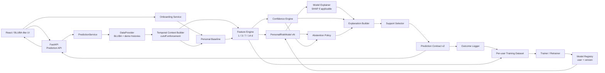
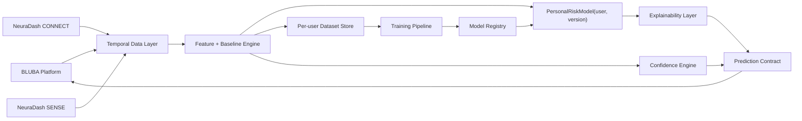

# Arquitectura técnica completa — NeuraDash CORE

## Veredicto arquitectónico

La arquitectura que construiría **ahora** es esta:

> **Monolito modular en Python/FastAPI + frontend React/TypeScript/Vite + pipeline temporal + un modelo predictivo individual por usuario + onboarding para cold start + modelos demo preentrenados con historiales longitudinales mockeados + inferencia síncrona + almacenamiento de ejemplos/outcomes + reentrenamiento versionado.**

No usaría microservicios, Kafka, Kubernetes ni infraestructura IoT como dependencia del MVP. Sí necesitamos persistencia suficiente para historial, modelos versionados, predicciones y outcomes; en demo puede resolverse de forma simple (archivos/SQLite), manteniendo una interfaz sustituible por PostgreSQL en piloto.

La separación importante no será **física** —muchos servicios— sino **lógica**:

```text
Frontend
   ↓
API estable
   ↓
Prediction Service
   ↓
Temporal Context
   ↓
Features + Baseline
   ↓
Personal Model vN ───── Confidence
   ↓                       ↓
Model Explainer + Abstention
   ↓
Support Selector
   ↓
Prediction Contract
```

El punto central es que **el frontend jamás dependerá del algoritmo concreto**. Cada usuario tendrá un `PersonalRiskModel` versionado detrás de una interfaz estable; el algoritmo podrá evolucionar con la cantidad de historial sin cambiar el contrato de producto.

Esta selección es consistente con el objetivo de la hackatón: CORE debe demostrar predicción mediante ML real. Para la presentación se crearán perfiles demo con historiales longitudinales mockeados, se entrenará previamente un modelo independiente para cada perfil y la aplicación cargará esos artefactos ya entrenados para realizar inferencia real. Los datos sintéticos sustituyen únicamente el historial que todavía no existe; no sustituyen al entrenamiento ni hardcodean la predicción.

La organización, además, pide explícitamente manejar información faltante, comunicar confianza, producir explicaciones y permite escenarios sintéticos o simulados.

### Supuestos y preguntas abiertas que afectan arquitectura

**[SUPUESTO]** Al menos una persona del equipo puede trabajar razonablemente con React/TypeScript y otra con Python. Si el equipo no domina frontend web, esta decisión merece reevaluarse; aun así, no recomendaría Streamlit como arquitectura final porque acoplaría demasiado UI y motor.

**[OPEN]** No conocemos todavía el mecanismo de integración real de BLUBA: API, acceso a BD, módulo interno, eventos, etc. Por ello crearemos una interfaz `DataProvider` y hoy su implementación será `CsvDataProvider`.

**[OPEN]** El outcome moderada/severa sigue siendo provisional. Cambiarlo deberá afectar configuración del motor/target, no frontend ni arquitectura.

**[OPEN]** Los CSV no entregan necesariamente `availability_timestamp` real. Para cualquier dato con timestamp ambiguo se aplicará una política conservadora y no se permitirá usarlo en el mismo día hasta confirmar cuándo estaba disponible.

---

# 1. Stack tecnológico recomendado

| Tecnología | Función | Por qué | Qué alternativa más compleja descarto |
|---|---|---|---|
| **React + TypeScript + Vite** | Frontend | Rápido de construir, contrato tipado, fácil futura integración web con BLUBA | Next.js: SSR, routing server-side y full-stack no solucionan ningún problema actual |
| **Tailwind CSS** | Estilos | Permite construir rápidamente una vista convincente | Design system propio: no alcanza a amortizarse |
| **Python 3.12+** | Dominio/analítica | Excelente para procesamiento temporal y futuro ML | Node para motor analítico: posible, pero Python facilita evolución a ciencia de datos |
| **FastAPI** | API/backend | Tipado, OpenAPI automático, integración natural con Pydantic | Django: ORM/admin/auth innecesarios; Flask: habría que montar más piezas manualmente |
| **Pydantic v2** | Contratos y validación | Previene objetos inconsistentes entre motor/API | JSON sin esquema: demasiado frágil |
| **pandas** | Ingesta y ventanas temporales MVP | CSV pequeños, operaciones de fechas y rolling muy rápidas de implementar | Spark/Polars distribuido: no existe volumen que lo justifique |
| **dateutil / zoneinfo** | Fechas/timezones | Comparación temporal segura | Timestamps naive |
| **scikit-learn** | Baselines de ML y validación | Permite empezar con modelos regularizados adecuados a pocos datos | Implementación propia de entrenamiento |
| **XGBoost (candidato)** | Gradient boosting tabular | Útil cuando el historial individual sea suficiente | Fijarlo como único algoritmo antes de validar |
| **SHAP (condicional)** | Explicabilidad del modelo | Explica contribuciones locales cuando el modelo activo sea compatible | Usarlo como explicación final sin traducción humana |
| **joblib / artefactos versionados** | Persistencia de modelos | Guarda `model_user_vN` y metadatos reproducibles | Reentrenar sin versionado |
| **PyYAML** | Configuración | Thresholds de seguridad, criterios de retraining y schemas versionables | Valores hardcodeados |
| **CSV + JSON** | Persistencia de entrada MVP | Es exactamente el formato disponible; máxima transparencia | PostgreSQL solamente para “parecer productivo” |
| **pytest** | Pipeline, features y modelos | Pruebas reproducibles de temporalidad, training, inferencia y promoción | Frameworks complejos |
| **FastAPI TestClient/httpx** | Integración API | Prueba input→contract | Infraestructura de test distribuida |
| **Vitest + React Testing Library** | Frontend | Verifica estados críticos | Cypress completo inicialmente |
| **Playwright** | 1 smoke test demo, si hay tiempo | Valida flujo browser real | Suite E2E amplia |
| **Docker, 1 único Dockerfile** | Reproducibilidad/deploy opcional | Sirve como paquete portable | Docker Compose con 5 contenedores |
| **GitHub/GitLab** | Repo/versionado | Evidencia técnica y trabajo colaborativo | CI/CD sofisticado |

### Qué NO utilizaría

No utilizaría actualmente:

```text
Kubernetes
Kafka
RabbitMQ
Redis
microservicios
PostgreSQL obligatorio
TimescaleDB
MongoDB
vector DB
embeddings
LLM
LangChain
MLflow
Airflow
Celery
feature store
GraphQL
Firebase
Supabase como dependencia central
IoT cloud
```

No porque sean malas tecnologías, sino porque no son necesarias para demostrar el ciclo central. **SHAP sí forma parte del MVP cuando el algoritmo activo lo requiera**, por ejemplo con XGBoost/gradient boosting.

---

# 2. Arquitectura técnica

## A. Arquitectura MVP



Todo puede vivir en **un solo backend** durante la hackatón. Son módulos, no microservicios.

### Flujo de inferencia

```text
registro diario
→ cutoff temporal
→ features + baseline
→ cargar modelo individual activo
→ predict
→ confidence / abstention
→ explanation
→ Prediction Contract
```

### Flujo de aprendizaje

```text
predicción en T
→ transcurren 24 h
→ cerrar outcome
→ agregar X,y al dataset del usuario
→ cuando hay suficiencia: entrenar candidato
→ validar contra versión activa
→ promover solo si mejora
```

### Cold start

El onboarding alimenta perfil y baseline inicial. Antes de contar con suficientes ejemplos etiquetados, un usuario real nuevo debe comunicar menor madurez/confianza y no presentar todavía un modelo personal como estable.

### Estrategia de demo de la hackatón

Para no depender de meses de uso real durante la hackatón, se crearán **perfiles demo predefinidos**, pero esos perfiles no contienen predicciones hardcodeadas. Cada perfil tendrá:

```text
profile.json                 → características del caso ficticio
onboarding.json              → respuestas iniciales simuladas
history.csv                  → historial longitudinal mockeado
outcomes.csv                 → eventos objetivo ocurridos/no ocurridos
training_dataset.parquet/csv → X,y derivados con cutoff temporal
model_v1.joblib              → modelo individual realmente entrenado
metadata.json                → algoritmo, features, métricas y versiones
```

El flujo de demostración será:

```text
perfil demo
→ historial mockeado
→ feature engineering
→ entrenamiento previo real
→ model_profile_v1
→ seleccionar perfil en la app
→ ingresar/cargar datos del día
→ inferencia con su modelo preentrenado
→ explicación SHAP si corresponde
→ risk + confidence
```

Por tanto, **perfil precreado ≠ predicción precreada**. El perfil y su historial son sintéticos; la predicción mostrada por la aplicación debe salir del artefacto ML entrenado para ese perfil.

Seleccionar `PAC-A`, `PAC-B` o `PAC-C` únicamente resuelve qué historial y qué `model_profile_vN` cargar. **Nunca debe resolver directamente un nivel de riesgo esperado.**

---

## B. Arquitectura futura

La arquitectura futura mantiene el mismo contrato y agrega fuentes, almacenamiento y validación más robustos. El núcleo continúa siendo **un modelo por usuario**, no un único predictor global.



El algoritmo concreto puede evolucionar, por ejemplo:

```text
RegularizedLogisticModel
        ↓ si existe suficiente historial y mejora validada
GradientBoosting/XGBoostModel
```

No se reconstruye NeuraDash: cambia la implementación/version del modelo individual.

---

## C. Límites de componentes

| Componente | Responsabilidad | Input | Output | No debe hacer |
|---|---|---|---|---|
| `Data Adapter` | Traducir BLUBA/CSV a esquema interno | CSV/BLUBA API | registros normalizados | Calcular riesgo |
| `Temporal Context Builder` | Aplicar `prediction_cutoff` y construir historia válida | registros + cutoff | contexto temporal válido | Usar datos futuros |
| `Feature Engine` | Crear recencia, tendencias, ventanas y cobertura | contexto | `FeatureSet` | Decidir riesgo final |
| `Personal Baseline` | Modelar patrón habitual individual | historia previa | `BaselineSnapshot` | Comparar contra estándares clínicos inventados |
| `PersonalRiskModel` | Inferir riesgo con parámetros aprendidos para un usuario | features + model version | `RiskAssessment` | Inferir confianza o modificar datos |
| `Confidence Engine` | Evaluar suficiencia/calidad de datos | features + coverage | `ConfidenceAssessment` | Cambiar el risk score |
| `Abstention Policy` | Determinar si se puede emitir estimación | risk + confidence + missing | boolean/reason | Inventar datos faltantes |
| `Model Explainer + Explanation Builder` | Obtener contribuciones del modelo y traducirlas | model + features + baseline | factores | Afirmar causalidad |
| `Support Selector` | Recuperar apoyos seguros | historial + catálogo | apoyos | Inventar tratamiento |
| `Prediction Contract` | Estabilizar backend/frontend | outputs anteriores | JSON v2 | Exponer implementación interna |
| `Frontend` | Presentar información y recibir interacción | contract | UI | Recalcular riesgo |

### Qué combinaría en el MVP

No fusionaría responsabilidades conceptualmente, pero físicamente:

```text
Temporal Context
Feature Engine
Baseline
```

pueden pertenecer al mismo paquete `engine/`.

Igualmente:

```text
Explanation
Support
```

pueden ser funciones pequeñas.

Lo que **no combinaría** bajo ninguna circunstancia es:

```text
Risk
Confidence
```

ni:

```text
PersonalRiskModel / Training Pipeline
Frontend
```

---

# 3. Estructura inicial del repositorio

```text
neuradash/
├── README.md
├── pyproject.toml
├── .env.example
├── Dockerfile
│
├── config/
│   ├── features.yaml
│   ├── training.yaml
│   ├── confidence_rules.yaml
│   └── abstention_rules.yaml
│
├── data/
│   ├── bluba/
│   │   ├── 1_casos_anonimizados.csv
│   │   ├── 2_programas_y_objetivos.csv
│   │   ├── 4_seguimiento_diario_tutor.csv
│   │   └── 5_eventos_desregulacion_tutor.csv
│   └── demo_profiles/
│       ├── PAC-A/
│       │   ├── profile.json
│       │   ├── onboarding.json
│       │   ├── history.csv
│       │   └── outcomes.csv
│       ├── PAC-B/
│       └── PAC-C/
│
├── ml/
│   ├── dataset_builder.py
│   ├── trainer.py
│   ├── evaluator.py
│   ├── model_registry.py
│   ├── inference.py
│   └── explain.py
│
├── models/
│   ├── PAC-A/
│   │   ├── model_v1.joblib
│   │   └── metadata_v1.json
│   ├── PAC-B/
│   └── PAC-C/
│
├── engine/
│   ├── schemas.py
│   ├── temporal.py
│   ├── features.py
│   ├── baseline.py
│   ├── confidence.py
│   ├── abstention.py
│   ├── explanation.py
│   ├── support.py
│   └── provenance.py
│
├── backend/
│   └── app/
│       ├── main.py
│       ├── schemas.py
│       ├── prediction_service.py
│       ├── data_provider.py
│       └── routes/
│           ├── subjects.py
│           ├── predictions.py
│           └── demo_profiles.py
│
├── frontend/
│   ├── package.json
│   ├── vite.config.ts
│   └── src/
│       ├── App.tsx
│       ├── api.ts
│       ├── types.ts
│       ├── pages/
│       │   └── SubjectRiskPage.tsx
│       └── components/
│           ├── RiskCard.tsx
│           ├── ConfidenceBadge.tsx
│           ├── FactorList.tsx
│           ├── MissingDataCard.tsx
│           ├── SupportCard.tsx
│           ├── Timeline.tsx
│           └── DemoProfileSwitcher.tsx
│
├── tests/
│   ├── unit/
│   │   ├── test_temporal.py
│   │   ├── test_features.py
│   │   ├── test_baseline.py
│   │   ├── test_training.py
│   │   ├── test_inference.py
│   │   ├── test_confidence.py
│   │   └── test_abstention.py
│   ├── demo_profiles/
│   │   └── test_profile_models.py
│   └── integration/
│       └── test_prediction_api.py
│
├── scripts/
│   ├── generate_mock_histories.py
│   ├── train_demo_models.py
│   ├── validate_source_data.py
│   └── smoke_demo.py
│
└── docs/
    ├── architecture.md
    ├── prediction-contract.md
    ├── data-dictionary.md
    └── assumptions-and-open-questions.md
```

`data/demo_profiles/` contiene los historiales sintéticos que representan meses de uso de cada perfil ficticio. `models/` contiene los artefactos realmente entrenados a partir de esos historiales. `ml/` implementa entrenamiento, evaluación, registro, inferencia y explicabilidad. `engine/` conserva la lógica temporal, baseline, confianza, abstención y apoyos, separada del algoritmo ML.

Los modelos demo deben poder regenerarse ejecutando:

```bash
python scripts/generate_mock_histories.py
python scripts/train_demo_models.py
```

Eso permite demostrar que los modelos no son archivos puestos manualmente ni predicciones hardcodeadas.

---

# 4. Modelo de datos

## Separación conceptual

```text
SOURCE DATA
↓
Subject
SensoryProfile
DailyRecord
DysregulationEvent
ProgramGoal
SupportStrategy
SupportHistory

DERIVED
↓
BaselineSnapshot
FeatureSnapshot

PREDICTION
↓
Prediction
PredictionFactor
ConfidenceAssessment
MissingData

TRAINING / DEMO
↓
DemoProfile
TrainingExample
ModelArtifact

PROVENANCE
↓
DataProvenance

ROADMAP
↓
PlannedEvent
SensorObservation
WearableObservation
```

## Entidades

| Entidad | ID | Campos clave | Timestamp relevante | Relaciones | Fase |
|---|---|---|---|---|---|
| `Subject` | `subject_id` | diagnóstico, rango edad, timezone | created/updated | 1:N registros | MVP |
| `SensoryProfile` | `sensory_profile_id` | modalidad, patrón, texto original | assessed_at | N:1 Subject | MVP |
| `DailyRecord` | `daily_record_id` | sleep, wake, GI, medication, regulation | `source_timestamp`, `availability_timestamp` | N:1 Subject | MVP |
| `DysregulationEvent` | `event_id` | type, intensity, trigger, support, result | `event_timestamp` | N:1 Subject | MVP |
| `ProgramGoal` | `goal_id` | area, objective, status | updated_at | N:1 Subject | MVP/contexto |
| `SupportStrategy` | `support_id` | label, source, validation | validated_at | N:M Subject | MVP |
| `SupportHistory` | `support_history_id` | support, context, outcome | used_at | Subject+Support | MVP |
| `BaselineSnapshot` | derived id | modality baselines, maturity | `as_of` | Subject | derivado |
| `FeatureSnapshot` | derived id | feature values + metadata | `as_of` | Subject | derivado |
| `Prediction` | `prediction_id` | cutoff, horizon, risk, confidence, abstain, versions | `as_of` | Subject | MVP |
| `PredictionFactor` | `factor_id` | code, comparison, direction, model contribution/SHAP | prediction time | N:1 Prediction | MVP |
| `ConfidenceAssessment` | `confidence_id` | level, index, coverage, recency | prediction time | 1:1 Prediction | MVP |
| `MissingData` | `missing_id` | field/source, age, priority | prediction time | N:1 Prediction | MVP |
| `DemoProfile` | `profile_id` | perfil, onboarding, origen mock | fixture timestamp | Subject demo | MVP/demo |
| `TrainingExample` | derived id | X, y, cutoff, provenance | `prediction_cutoff` | Subject | MVP |
| `ModelArtifact` | `model_id` | subject_id, version, family, path, metrics | trained_at | Subject | MVP |
| `DataProvenance` | `provenance_id` | origin, synthetic flag, source file | source dependent | cualquier dato | MVP |
| `PlannedEvent` | `planned_event_id` | novelty, routine change, sensory demand | `start_time` | Subject | roadmap |
| `SensorObservation` | `observation_id` | signal, value, unit, window | observed_at | Subject/device | roadmap |
| `WearableObservation` | `wearable_obs_id` | sleep/activity/HR | observed_at | Subject/provider | roadmap |

### Cada dato temporal debería poder reconstruir

```yaml
source_timestamp:
availability_timestamp:
prediction_cutoff:
source:
data_origin:
```

No basta con guardar `fecha`.

---

## Qué almacenar vs calcular

### MVP

Persistir:

```text
CSV BLUBA + historiales longitudinales mockeados por perfil demo
onboarding por usuario
historial normalizado
feature snapshots usados para entrenamiento/inferencia
predicciones
outcomes cerrados
datasets supervisados por usuario
modelos individuales versionados
metadatos de entrenamiento y validación
```

Calcular on-demand:

```text
baseline actualizado
features
predicción con model_user_vN
confidence
explicación
```

Guardar predicción + features + outcome es obligatorio porque alimenta auditoría **y reentrenamiento**.

### Piloto/producción

Persistir cada `Prediction` junto a `prediction_cutoff`, `model_version`, `feature_schema_version`, `contract_version`, provenance, explicación, missingness y abstention; además conservar datasets/versiones de entrenamiento reproducibles y el resultado de comparación entre candidato y modelo activo.

---

# 5. Contrato API

## Endpoints MVP

### 1. Obtener sujeto

```http
GET /api/v1/subjects/{subject_id}
```

Response:

```json
{
  "subject_id": "PAC-002",
  "age_range": "6-7",
  "diagnosis": "TEA",
  "sensory_profile": "Hipersensible Auditivo y Evitador Táctil"
}
```

Errores:

```text
404 sujeto inexistente
500 error interno sanitizado
```

---

### 2. Obtener timeline

```http
GET /api/v1/subjects/{subject_id}/timeline?as_of=2026-07-20T08:30:00-04:00&days=14
```

Devuelve solamente información válida hasta `as_of`.

Esto es importante: **el backend también aplica cutoff al endpoint de timeline**.

---

### 3. Generar estimación

```http
POST /api/v1/predictions
```

Request:

```json
{
  "subject_id": "PAC-002",
  "as_of": "2026-07-20T08:30:00-04:00",
  "horizon": "next_24h"
}
```

No permitiría que el cliente mande las features calculadas.

El backend debe obtenerlas.

---

### 4. Demo con modelos preentrenados

```http
POST /api/v1/demo/profiles/{profile_id}/predict
```

Ejemplos:

```text
PAC-A
PAC-B
PAC-C
```

Cada `profile_id` resuelve a un historial sintético y a un `model_vN` **previamente entrenado** para ese perfil. El endpoint no contiene reglas del tipo `PAC-A → ELEVATED`; ejecuta exactamente el mismo pipeline de features + carga de modelo + inferencia + explicación que usaría un usuario real.

Opcionalmente:

```http
POST /api/v1/demo/profiles/{profile_id}/retrain
```

se puede utilizar durante la demo técnica para mostrar cómo nuevos ejemplos mockeados producen un candidato `model_vN+1`, que luego se evalúa antes de promoverse.

---

## Prediction Contract v2

Recomiendo extender ligeramente el contrato propuesto:

```json
{
  "contract_version": "2.0",

  "prediction_id": "pred-demo-001",
  "subject_id": "PAC-002",

  "as_of": "2026-07-20T08:30:00-04:00",
  "horizon": "next_24h",

  "risk_level": "ELEVATED",
  "model_score": 0.64,

  "model_version": "PAC-002-v3",
  "model_family": "xgboost",

  "confidence_level": "HIGH",

  "abstain": false,
  "abstention_reason": null,

  "factors": [
    {
      "code": "recent_event_load",
      "label": "Eventos recientes",
      "comparison": "1 episodio moderado/severo en los últimos 3 días",
      "direction": "up",
      "window": "3d"
    }
  ],

  "missing": [],

  "priority_data_request": null,

  "support": [
    {
      "support_id": "SUP-003",
      "source": "historical_support",
      "label": "Revisar apoyos previamente efectivos"
    }
  ],

  "data_provenance": {
    "contains_synthetic_data": true,
    "origins": [
      "BLUBA_CSV",
      "mock_longitudinal_history_from_BLUBA_schema"
    ]
  },

  "technical_metadata": {
    "engine": "personal_ml",
    "training_strategy_version": "train-v0.1",
    "explainer": "shap",
    "confidence_ruleset_version": "confidence-v0.1",
    "feature_schema_version": "0.1"
  }
}
```

### Importante

`INSUFFICIENT` no es un error HTTP.

Es un **resultado válido de negocio**:

```http
HTTP 200
```

con:

```json
{
  "confidence_level": "INSUFFICIENT",
  "abstain": true
}
```

---

# 6. Flujos principales

## Flujo A — estimación normal

```text
Paso 1
→ Frontend solicita predicción con subject_id + as_of

Paso 2
→ Backend obtiene historial

Paso 3
→ Temporal Context elimina cualquier dato posterior al cutoff

Paso 4
→ Feature Engine calcula ventanas 1/3/7/14

Paso 5
→ Baseline calcula patrón individual

Paso 6
→ Model Registry carga el modelo individual activo y `PersonalRiskModel` calcula el score

Paso 7
→ Confidence Engine evalúa calidad de información

Paso 8
→ Abstention Policy permite continuar

Paso 9
→ SHAP/Model Explainer obtiene contribuciones y Explanation Builder las traduce a factores

Paso 10
→ Support Selector recupera apoyos válidos

Paso 11
→ Backend construye Prediction Contract

Paso 12
→ UI muestra riesgo + confianza + explicación
```

---

## Flujo B — información insuficiente

```text
faltan últimos 3 días
→
coverage_3d cae
→
recency empeora
→
confidence = INSUFFICIENT
→
hard abstention = true
→
risk no se muestra como estimación normal
→
missingness ranker busca dato de mayor valor
→
"¿Cómo fue el sueño reciente?"
```

La lógica crítica es:

```text
null
≠
normal
```

---

## Flujo C — personalización

Niño A:

```text
historial:
90% noches reparadoras

hoy:
sueño interrumpido
```

Niño B:

```text
historial:
45% noches reparadoras

hoy:
sueño interrumpido
```

Entonces:

```text
misma observación absoluta
↓
distinta desviación respecto del baseline
↓
distinta contribución
↓
distinta explicación
```

---

# 7. Diseño del pipeline de ML individual

## Principio

El riesgo **no se calcula sumando puntos manuales**. Cada perfil/usuario dispone de un modelo supervisado propio entrenado con su historial longitudinal.

Para la hackatón:

```text
perfil demo sintético
→ historial mockeado suficientemente largo
→ construir ejemplos temporales X,y
→ entrenar modelo individual
→ validar
→ guardar model_profile_v1
→ usar ese modelo en la demo
```

En producción cambia el origen del historial, no el pipeline:

```text
usuario real
→ onboarding + registros reales
→ historial longitudinal real
→ construir X,y
→ entrenar model_user_v1
→ acumular nuevos outcomes
→ reentrenar model_user_v2, v3...
```

## Representación de features

Cada feature conserva provenance y cutoff para evitar leakage:

```python
FeatureValue(
    code="event_count_3d",
    value=1,
    window="3d",
    source="dysregulation_events",
    source_timestamps=[...],
    prediction_cutoff=...,
    leakage_risk="low",
    data_origin="mock_demo"  # o BLUBA_REAL en producción
)
```

Features candidatas:

```text
event_count_1d / 3d / 7d / 14d
time_since_last_event
max_event_intensity_3d
sleep_quality_delta_baseline
sleep_trend_3d / 7d
wake_state_delta_baseline
previous_day_regulation
day_coverage_3d / 7d
baseline_maturity
variables de onboarding/contexto seleccionadas
```

## Construcción del dataset supervisado

La unidad de entrenamiento es:

```text
usuario × prediction_cutoff T
```

con:

```text
X(T) = solo información disponible hasta T
y(T) = 1 si ocurre el evento objetivo en (T, T+24h]
       0 en caso contrario
```

Para cada perfil demo se genera una secuencia longitudinal coherente. El mock debe producir tanto días negativos como positivos y patrones distintos entre perfiles, de forma que cada modelo tenga algo diferente que aprender.

Ejemplo conceptual:

```text
PAC-A
sueño alterado + eventos recientes → asociación histórica más fuerte
ruido → menor señal histórica

PAC-B
exposición auditiva + cambio de rutina → asociación histórica más fuerte
sueño irregular → más habitual y menos discriminante
```

Estas relaciones se incorporan **al generador de datos mock**, no al código de inferencia. Después el algoritmo debe aprenderlas desde los ejemplos generados.

## Algoritmo

La familia exacta sigue siendo `PROVISIONAL` hasta comparar alternativas por perfil.

Candidatos iniciales:

```text
1. LogisticRegression regularizada
2. Gradient Boosting / XGBoost
```

Para la demo se puede seleccionar una sola familia si simplifica la implementación, pero debe entrenarse realmente para cada perfil. XGBoost es válido si el volumen mockeado por perfil es suficiente y la validación no muestra sobreajuste.

No se permite:

```text
profile_id == PAC-A → riesgo alto
regla sueño_interrumpido → +15
bonus acumulación → +5
```

El output de riesgo debe provenir de:

```python
model = registry.load_active(subject_id)
X = feature_engine.transform(context, baseline)
score = model.predict_proba(X)[0, 1]
```

Si el modelo no está calibrado, `score` debe comunicarse como **score del modelo** o convertirse a niveles LOW/MEDIUM/ELEVATED mediante thresholds de producto, sin venderlo como probabilidad clínica validada.

## Ventanas temporales

Se construirán como mínimo:

```text
1d
3d
7d
14d
```

Ejemplo:

```text
event_count → 1/3/7/14
sleep trend → 3/7
time_since_event → continuo
coverage → 3/7
```

## Baseline individual

El baseline sigue siendo parte central de las features. Para datos ordinales puede usar mediana, moda, frecuencia y rolling rate; para variables continuas futuras, median, MAD, rolling median y delta.

El objetivo no es reemplazar el modelo, sino convertir observaciones absolutas en información relativa al patrón del usuario:

```text
valor actual - comportamiento habitual → desviación individual → feature del modelo
```

## Entrenamiento de modelos demo

El entrenamiento debe ejecutarse **antes de la presentación** y dejar artefactos reproducibles:

```text
PAC-A history/outcomes → dataset_A → train → model_A_v1.joblib
PAC-B history/outcomes → dataset_B → train → model_B_v1.joblib
PAC-C history/outcomes → dataset_C → train → model_C_v1.joblib
```

Cada `metadata_v1.json` debería registrar:

```yaml
subject_id: PAC-A
model_version: v1
model_family: xgboost
feature_schema_version: 0.2
training_data_origin: mock_longitudinal_history
training_rows: ...
positive_examples: ...
validation_strategy: temporal_split
metrics:
  auprc: ...
  brier: ...
created_at: ...
```

Las métricas obtenidas sobre datos mockeados sirven para validar el **pipeline técnico** y comparar versiones del modelo dentro de la demo. No deben presentarse como rendimiento clínico real.

## Inferencia

```python
def predict_for_subject(subject_id, as_of):
    context = temporal_context(subject_id, as_of)
    baseline = build_baseline(context)
    features = build_features(context, baseline)

    model = model_registry.load_active(subject_id)
    score = model.predict_proba([features.vector])[0, 1]

    return score, features, model.metadata
```

El mismo código debe servir para un perfil demo y, más adelante, para un usuario real.

## Confidence

`confidence` continúa separado de `risk`.

Puede considerar:

```text
temporal completeness
recency
baseline maturity
source coverage
training example count
positive example count
model stability / calibration evidence
```

En la hackatón, los thresholds de confianza son configuración de ingeniería y deben identificarse como tales.

## Hard abstention

Las reglas manuales sí permanecen aquí porque son reglas de seguridad, no reglas de predicción.

Ejemplos:

```python
def should_abstain(context, confidence, model_metadata):
    if context.hours_since_last_daily_record > 48:
        return True, "daily_record_too_old"
    if context.day_coverage_3d < 0.50:
        return True, "recent_coverage_insufficient"
    if model_metadata is None:
        return True, "personal_model_not_available"
    if confidence.level == "INSUFFICIENT":
        return True, "insufficient_confidence"
    return False, None
```

## Explicabilidad

Si el modelo activo es XGBoost/gradient boosting compatible, se utilizará SHAP para obtener contribuciones locales.

```text
model prediction
→ SHAP values
→ top factores
→ Explanation Builder
→ lenguaje comprensible
```

Ejemplo:

```text
Riesgo elevado

Factores que más empujaron esta predicción:
↑ sueño reciente muy distinto de su patrón habitual
↑ dos eventos recientes
↑ cambio de rutina
```

SHAP explica la salida del modelo; no demuestra causalidad. El `Explanation Builder` debe transformar contribuciones técnicas a lenguaje comprensible y evitar frases como “el sueño causará una desregulación”.

## Support

Los apoyos no se generan desde el modelo predictivo. Se recuperan desde historial/catalogación validada y se muestran separados de los factores de riesgo.

## Pipeline completo

```text
                  PERFIL DEMO / USUARIO
                           ↓
                 historial longitudinal
                           ↓
                Temporal Context Builder
                           ↓
               Features + Personal Baseline
                           ↓
                  PersonalRiskModel vN
                           ↓
                  model score / risk level
                      ↙              ↘
                  SHAP             Confidence
                    ↓                  ↓
              Explanation         Abstention
                      ↘              ↙
                   Prediction Contract
                           ↓
                         UI
                           ↓
                    outcome posterior
                           ↓
                  dataset individual
                           ↓
               retraining + validación
                           ↓
                    model vN+1
```

---

# 8. Persistencia

| Opción | Ventaja | Problema | Uso |
|---|---|---|---|
| CSV/JSON | Cero infraestructura, transparente, reproducible | Malo para concurrencia/escrituras | **Hackatón** |
| SQLite | ACID, archivo único, SQL | Concurrencia limitada | piloto standalone pequeño |
| PostgreSQL | robusto, concurrencia, índices, JSON, backups | más infraestructura | piloto BLUBA/producción |

## Decisión

### Hackatón

```text
CSV BLUBA como ancla estructural
+
data/demo_profiles/* con historiales mockeados
+
models/* con artefactos preentrenados
+
metadatos de training/validación
+
inferencia local
```

No se necesita una DB productiva para la demo. Los modelos se entrenan previamente y se empaquetan con la aplicación; opcionalmente SQLite puede registrar nuevas predicciones/outcomes durante la demostración.

### Piloto

**[OPEN]**

Si el piloto es una instalación independiente:

```text
SQLite
```

puede bastar.

Pero si el piloto se integra realmente en BLUBA y tendrá usuarios simultáneos:

> iría directamente a **PostgreSQL**.

No tiene mucho sentido migrar BLUBA→SQLite→Postgres solo para cumplir una etapa artificial.

### Producción

```text
PostgreSQL
```

No introduciría una base time-series adicional inicialmente.

---

# 9. Decisiones arquitectónicas principales

## D1 — Monolito modular

**Decisión:** FastAPI + engine en un deploy.

**Razón:** elimina coordinación distribuida sin sacrificar separación interna.

**Alternativa descartada:** microservicios.

**Costo:** módulos comparten proceso.

**Evolución:** separar solamente cuando carga, ownership o deployment independiente lo justifique.

---

## D2 — Frontend y backend separados conceptualmente

**Decisión:** React consume API estable.

**Razón:** BLUBA podrá incorporar otra UI sin portar el motor.

**Alternativa:** lógica en React.

**Costo:** existe integración HTTP incluso en un MVP.

**Evolución:** backend puede integrarse con BLUBA directamente.

---

## D3 — PersonalRiskModel por usuario y versionado

**Decisión:** interfaz estable:

```python
PersonalRiskModel.predict(features)
ModelRegistry.load_active(subject_id)
Trainer.train(subject_dataset)
```

**Razón:** la variabilidad entre casos es parte central del producto. Cada perfil demo de la hackatón tendrá un modelo realmente entrenado sobre su propio historial mockeado; en producción cada usuario acumulará su historial real y tendrá sus propias versiones.

**Alternativa descartada:** motor heurístico común con pesos manuales o un único modelo global como predictor principal.

**Costo:** requiere suficientes ejemplos por usuario, manejar cold start y versionar múltiples artefactos.

**Evolución:** `model_user_v1 → v2 → v3`, promoviendo una nueva versión solo tras validación.

---

## D4 — Risk ≠ Confidence

**Decisión:** dos objetos independientes.

**Razón:** riesgo describe patrón; confianza describe información.

**Alternativa:** bajar automáticamente el riesgo cuando faltan datos.

**Costo:** UX debe explicar dos dimensiones.

**Evolución:** confidence puede incorporar estabilidad y calibración observada de la versión activa del modelo individual, sin confundirse con el risk score.

---

## D5 — CSV/JSON para MVP

**Decisión:** no DB.

**Razón:** los datasets mockeados y modelos preentrenados pueden empaquetarse como archivos reproducibles; las escrituras de la demo pueden mantenerse mínimas.

**Alternativa:** PostgreSQL.

**Costo:** no escala.

**Evolución:** DataProvider permite cambiar almacenamiento.

---

## D6 — Predicción síncrona

**Decisión:** request → cálculo → response.

**Razón:** un niño × ~14–30 días cuesta prácticamente nada.

**Alternativa:** workers/colas.

**Costo:** batch masivo futuro requerirá otra estrategia.

**Evolución:** mantener predicción interactiva síncrona y añadir jobs para forecasts masivos.

---

## D7 — CORE independiente de CONNECT/SENSE

**Decisión:** señales IoT son inputs opcionales.

**Razón:** el producto debe seguir funcionando sin hardware.

**Alternativa:** hacer que sensores sean requisito.

**Costo:** CORE tiene menos señales objetivas inicialmente.

**Evolución:** adapters nuevos, no cambios al motor general.

---

# 10. Escalabilidad real

No conocemos el número de usuarios de producción, así que no voy a inventarlo.

## Decenas de niños

Arquitectura actual prácticamente intacta.

```text
FastAPI
Postgres o SQLite
1 proceso
```

---

## Cientos

```text
FastAPI stateless
PostgreSQL
índices subject_id + timestamp
```

Nada más.

---

## Miles

Aparece el primer punto real de escalamiento:

> recalcular miles de forecasts periódicamente.

Entonces:

```text
API interactiva
+
worker/background job
+
PostgreSQL
```

Todavía no necesito microservicios.

---

## Decenas de miles

Consideraría:

```text
múltiples replicas FastAPI
workers horizontales
PostgreSQL particionado/indexado
pool de conexiones
cache selectiva
observabilidad real
```

Y solo si las métricas lo exigen:

```text
Redis
particionamiento temporal
read replicas
```

No introduciría Kafka automáticamente.

---

# 11. Riesgos técnicos

| Riesgo | Prob. | Impacto | Mitigación MVP | Futuro |
|---|---|---|---|---|
| Leakage temporal | Alta | Crítico | `availability_timestamp` + tests | feature registry temporal |
| Timestamp ambiguo | Alta | Crítico | excluir mismos días dudosos | capturar timestamp real |
| Missing = normal | Media | Crítico | representación explícita | data-quality service |
| Frontend acoplado al score | Media | Alto | Prediction Contract | API versionada |
| Score del modelo interpretado como probabilidad clínica | Alta | Alto | etiquetar `model_score` y no afirmar calibración clínica | calibración con datos reales |
| Datos sintéticos mezclados | Media | Alto | provenance obligatorio | lineage completo |
| Perfil demo confundido con predicción hardcodeada | Alta | Crítico | entrenar artefacto real por perfil y mostrar metadata | historial real por usuario |
| Configuration drift | Media | Alto | YAML versionado | config registry/deployment version |
| Baseline inmaduro | Alta | Alto | confidence + abstention | onboarding y cohortes |
| Sobreajuste por usuario | Alta | Crítico | historial mock suficiente + validación temporal + regularización | más datos reales por usuario |
| Performance batch futura | Baja MVP | Medio futuro | cálculo on-demand | workers/precompute |
| Privacidad de menores | Baja demo | Crítico | datos anonimizados | seguridad completa |
| API BLUBA distinta a supuestos | Media | Alto | DataProvider abstraction | adapter real |
| Sensor interpretado causalmente | Media futura | Alto | lenguaje contextual | estudios de validación |

---

# 12. Seguridad y privacidad

## Demo

Necesario ya:

```text
IDs anonimizados
no PII
no nombres reales
no direcciones
no logs de payload completos
no secretos en repo
.env fuera de Git
datos sintéticos identificados
sin audio
sin GPS
sin cámara
```

La demo no necesita fingir:

```text
OAuth productivo
RBAC
IAM
KMS
```

---

## Antes de producción

Se vuelve obligatorio:

### Separación de PII

```text
identity service / BLUBA
        ↓ subject_id pseudónimo
NeuraDash analytical domain
```

NeuraDash no necesita conocer:

```text
RUT
dirección
teléfono
nombre completo
```

para calcular una feature de sueño.

### Cifrado

```text
TLS en tránsito
cifrado at-rest
gestión de claves
backups cifrados
```

### Acceso

BLUBA debería controlar:

```text
quién puede ver cada niño
quién es el cuidador a cargo
qué puede hacer la familia
```

No reinventaría autenticación en NeuraDash.

### Logs

Sí:

```text
prediction_id
subject pseudonymous id
model_version
model_family
feature_schema_version
status
latency
```

No:

```text
observaciones clínicas completas
audio
PII
```

### Auditoría

Registrar:

```text
quién solicitó
cuándo
cutoff
model_version
model_family
feature_schema_version
versión contrato
resultado
datos disponibles
```

### Retención

Definir políticas distintas para:

```text
datos fuente
predicciones
logs técnicos
sensor raw
```

### Sensores

Principio:

```text
raw signal
→ local processing
→ aggregate feature
→ discard raw
```

Particularmente para audio:

```text
micrófono
→ RMS/dB/peaks
→ eliminar audio
```

---

# 13. Testing

## Unitarios

### Temporal

```text
ningún dato posterior al cutoff
```

### Features

```text
event_count_3d correcto
sleep streak correcto
coverage correcto
```

### Baseline

```text
mismo dato
+
dos historiales
→
desviaciones distintas
```

### Training / inference

```text
cada perfil demo genera un dataset supervisado distinto
→ se entrena un artefacto distinto
→ la inferencia carga el modelo correspondiente al subject_id
```

### Confidence

```text
menos cobertura
→ nunca aumenta confianza
```

### Abstention

```text
información insuficiente
→ abstain true
```

---

## Tests de perfiles demo

```text
PAC-A
→ existe model_A_v1 entrenado
→ metadata identifica origen mock
→ inferencia responde con ese modelo

PAC-B
→ existe model_B_v1 entrenado
→ modelo distinto de PAC-A

personalización
→ los mismos datos del día pueden producir scores/factores distintos al cargarse modelos personales diferentes

reproducibilidad
→ regenerar dataset + entrenar con la misma seed produce resultados equivalentes dentro de tolerancia

insufficient
→ si faltan datos requeridos, confidence cae o el sistema se abstiene
```

---

## Test de leakage obligatorio

```python
def test_future_record_is_never_used():
    cutoff = dt("2026-07-20T08:30:00-04:00")

    context = build_temporal_context(
        records=[
            record(availability="2026-07-20T08:00:00-04:00"),
            record(availability="2026-07-20T09:00:00-04:00"),
        ],
        prediction_cutoff=cutoff
    )

    assert len(context.records) == 1
```

---

## Integración

```text
demo profile
→ cargar model_profile_v1
→ construir features del día
→ predict_proba / predict
→ SHAP si aplica
→ Prediction Contract
→ frontend
```

Como smoke test:

```text
1. seleccionar PAC-A
2. verificar que metadata muestre model_A_v1
3. ejecutar una predicción
4. seleccionar PAC-B
5. verificar que carga model_B_v1
6. ejecutar la misma entrada o una entrada comparable
7. observar que el resultado proviene del modelo personal correspondiente
8. abrir un caso con datos insuficientes y verificar abstención/confianza
```

---

# 14. Deployment MVP

La decisión más práctica es:

> **desarrollo frontend/backend separado; build final servido desde el mismo proceso FastAPI.**

## Desarrollo

Terminal 1:

```bash
uv run uvicorn backend.app.main:app --reload --port 8000
```

Terminal 2:

```bash
cd frontend
npm run dev
```

Vite usa proxy:

```text
/api → localhost:8000
```

---

## Demo congelada

Construir frontend:

```bash
cd frontend
npm ci
npm run build
```

FastAPI sirve:

```text
frontend/dist/
```

Así el deployment final es:

```text
1 proceso
1 URL
1 backend
0 servicios externos
```

---

## Datos

Empaquetados en:

```text
data/bluba
data/demo_profiles
models
config
```

No dependen de internet.

---

## Presentación presencial

Orden de prioridad:

```text
1. Demo local en localhost
2. Public deployment como respaldo/QR
3. Video grabado
4. Screenshots
```

Nunca al revés.

### Public link

Si quieren enlace:

```text
single Docker image
→ Render / Railway / Fly.io / servidor equivalente
```

No utilizaría ninguna feature propietaria del proveedor.

Eso hace el deploy sustituible.

---

# 15. Ruta de evolución

| Fase | Qué cambia | Se reutiliza | Riesgo principal |
|---|---|---|---|
| **0 Hackatón** | historiales mockeados por perfil + entrenamiento previo real + modelos individuales preentrenados + inferencia + retraining demo | contratos y pipeline | realismo del mock y sobreajuste |
| **1 Piloto BLUBA** | persistencia real, auth, timestamps, más historia por usuario | arquitectura completa | calidad del outcome |
| **2 Madurez individual** | más ejemplos y positivos por usuario | datasets/model registry | decidir cuándo cambiar de algoritmo |
| **3 Optimización de modelos** | benchmark logística vs boosting/XGBoost u otros | interfaz PersonalRiskModel | sobreajuste/calibración |
| **4 CONNECT** | sueño/actividad/HR | DataProvider/FeatureEngine | calidad incremental |
| **5 SENSE** | ruido/IMU/luz/EDA | adapters/features | privacidad/ruido |
| **6 Validación productiva** | calibración, utilidad, thresholds | plataforma completa | claims y seguridad |

## Fase 0 — Hackatón

Construimos y demostramos:

```text
perfiles demo definidos
historial longitudinal mockeado por perfil
generación de X,y con temporalidad correcta
training real por perfil
model registry con model_PAC-A_v1, model_PAC-B_v1, ...
inferencia diaria usando el modelo preentrenado seleccionado
SHAP cuando corresponda
confidence / abstention
outcome logging
retraining de una nueva versión como demostración del ciclo futuro
```

## Fase 1 — Piloto BLUBA

Se reemplaza la persistencia de demo por almacenamiento productivo y se capturan outcomes/timestamps reales. No cambia la interfaz `PersonalRiskModel` ni el Prediction Contract.

## Fase 2/3 — madurez y optimización

Cada usuario puede evolucionar de un modelo regularizado a uno más expresivo solo cuando su historial lo permita y la validación muestre mejora.

---

# SEXTO — solo si sobra tiempo

En este orden:

```text
1. visualización bonita del baseline
2. micro-check-in tutor
3. provenance desplegable
4. deploy público
5. comparación A/B de dos niños
6. planned event mock
7. CONNECT mock
8. sensor acústico físico
```

No:

```text
LLM de recomendaciones
CNN sin justificación
login completo
RBAC
notificaciones push
IoT cloud
Kafka
modelo global único como sustituto de la personalización individual
```

---

# Decisión final de construcción

Si mañana tuviera que revisar el repositorio, esperaría ver este camino crítico:

```text
                    DEMO PREPARATION

DemoProfileGenerator
        ↓
mock history + outcomes por perfil
        ↓
Temporal Dataset Builder
        ↓
FeatureEngine + PersonalBaseline
        ↓
Trainer
        ↓
model_PAC-A_v1 / model_PAC-B_v1 / ...
        ↓
ModelRegistry

                    RUNTIME

registro/datos del día
        ↓
TemporalContextBuilder
        ↓
FeatureEngine + PersonalBaseline
        ↓
ModelRegistry.load_active(subject_id)
        ↓
PersonalRiskModel.predict
        ├──────────────→ ConfidenceEngine
        ↓
SHAP / ModelExplainer
        ↓
ExplanationBuilder
        ↓
Abstention + SupportSelector
        ↓
PredictionContract
        ↓
FastAPI
        ↓
React / BLUBA-like UI
```

La demo debe probar realmente que:

```text
cada perfil tiene un historial mockeado propio

cada perfil tiene un modelo ML realmente entrenado propio

la predicción no está hardcodeada por profile_id

el mismo pipeline sirve para demo y producción

futuro nunca entra al forecast

missing ≠ normal

risk ≠ confidence

baseline aporta personalización

SHAP explica el modelo cuando corresponde

los datos sintéticos están identificados

los artefactos de modelo están versionados

nuevos outcomes pueden alimentar retraining

CORE funciona sin sensores
```

La historia de la hackatón, por tanto, no es “tenemos perfiles preconfigurados que simulan riesgo”. Es:

> **Creamos historiales sintéticos realistas para representar meses de uso que todavía no existen, entrenamos de verdad un modelo independiente para cada perfil y usamos esos modelos preentrenados para hacer predicciones en la aplicación. En producción, el mismo ciclo utilizará los registros reales acumulados por cada usuario y generará nuevas versiones de su modelo con el tiempo.**

---

# Fuentes del proyecto utilizadas

- `NeuraDash_Source_of_Truth_Contexto_Maestro_NeuroHack_2026.md`
- `Bases Hackatón FICA 2026 2S.pdf`
- `6. Presentación Desafío BLUBA.pdf`
- `3. Presentación Bases Hackatón.pdf`
- `NeuroHack_2026_Plan_Operativo_Competitivo(1)(1).pdf`
- `Estrategia_Datos_BLUBA_NeuroHack_2026_V2_Perfiles_Sensoriales(1).md`
- `BLUBA_Sensorizacion_IoT_Extension_Motor_Predictivo_NeuroHack_2026(1).md`
- `NeuroHack_2026_War_Room_PreTaller_BLUBA(1).md`
