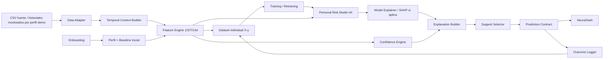
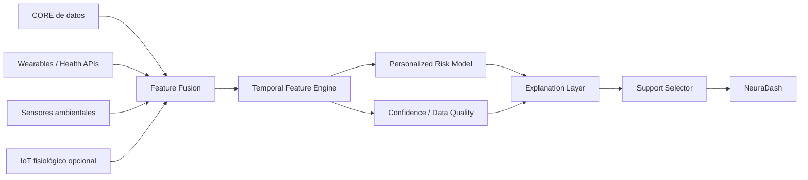

# NeuraDash — Source of Truth y Contexto Maestro del Proyecto

**Equipo / solución:** NeuraDash  
**Estado del documento:** Source of Truth operativo y técnico  
**Propósito:** servir como contexto único para desarrollo, arquitectura, datos, UX, demo y documentación.  
**Regla de uso:** si una idea, implementación o claim contradice este documento, debe detenerse y revisarse antes de incorporarse.  
**Fecha de consolidación:** 26 de agosto de 2026

---

# 0. RESUMEN EJECUTIVO

NeuraDash es una **aplicación de alerta temprana concebida desde cero** que transforma registros cotidianos e históricos en una **estimación personalizada de riesgo de desregulación para las próximas 24 horas**, acompañada de un **nivel independiente de confianza**, una **explicación comprensible de los factores que influyen** y **apoyos previamente registrados o validados** que pueden considerarse.

NeuraDash **no es una IA clínica validada**, **no afirma que una crisis ocurrirá**, **no diagnostica** y **no prescribe tratamiento**.

Su tesis central es:

> Las familias registran a diario información valiosa sobre el día a día del niño, pero esa información es longitudinal, heterogénea, incompleta y difícil de interpretar anticipadamente. NeuraDash convierte ese historial en una señal prospectiva y contextualizada: aprende qué es habitual para cada niño, detecta cambios y acumulaciones relevantes, separa riesgo de confianza, explica qué cambió y permite actuar preventivamente sin ocultar incertidumbre.

La arquitectura del proyecto se divide en tres capas:

```text
NEURADASH CORE
=
datos actuales de la persona
+
memoria temporal
+
baseline individual
+
perfil sensorial contextual
+
motor de riesgo
+
motor de confianza
+
abstención
+
explicación
+
apoyos contextualizados
```

```text
NEURADASH CONNECT
=
integración futura con wearables existentes
para sueño, actividad y otras señales pasivas
```

```text
NEURADASH SENSE
=
sensores especializados o ambientales opcionales
para aportar variables que hoy dependen del registro manual
```

El MVP debe demostrar principalmente **CORE**. CONNECT y SENSE se utilizan como **extensión arquitectónica y demostración de escalabilidad**, no como requisito para que la solución funcione.

La decisión metodológica central es **entrenar un modelo predictivo individual por usuario**. Cada niño tendrá su propio historial, baseline, dataset supervisado y versiones de modelo. El sistema realizará predicciones con los registros diarios y, cuando se acumulen suficientes ejemplos nuevos con outcome conocido, reentrenará una nueva versión del modelo individual y solo la promoverá si supera la versión anterior según criterios de validación definidos.

Los CSV entregados siguen siendo demasiado pequeños para afirmar performance clínica: contienen 4 casos, 102 registros diarios, 37 sesiones de seguimiento y 7 eventos explícitos de desregulación. Por ello sirven como ancla estructural y para construir el pipeline; para demostrar entrenamiento y reentrenamiento se podrán utilizar **historias longitudinales mockeadas explícitas por perfil demo**, sin presentarlos como evidencia clínica.

Para usuarios nuevos, NeuraDash incorpora un **cuestionario de onboarding** que construye contexto inicial y baseline provisional. El onboarding reduce el problema de cold start, pero no sustituye los ejemplos supervisados `X → y` necesarios para entrenar un modelo individual.

Para la demo, NeuraDash utilizará:

```text
datos históricos reales como ancla estructural
+
onboarding y baseline individual
+
features temporales derivadas
+
historias longitudinales mockeadas transparentes por perfil demo
+
modelo predictivo entrenado por usuario
+
versionado y reentrenamiento demostrable
```

El resultado debe demostrar aprendizaje técnico y personalización sin confundir el prototipo con una validación clínica.

---

# 1. JERARQUÍA DE AUTORIDAD

Este documento distingue explícitamente qué tipo de verdad representa cada decisión.

## 1.1 Orden de autoridad

Cuando exista una contradicción:

1. bases oficiales del proyecto;
2. respuestas explícitas posteriores;
3. datos reales entregados;
4. evidencia científica;
5. decisiones de producto e ingeniería del equipo;
6. análisis internos;
7. ideas o apuntes.

Una idea atractiva no puede reemplazar una restricción oficial ni convertir una hipótesis en evidencia.

## 1.2 Tipos de verdad

### [OFICIAL]

Define lo que las bases del proyecto piden.

Ejemplo:

> El sistema debe considerar datos incompletos, confianza, facilidad de registro y explicaciones comprensibles.

### [DATO]

Define lo que realmente está presente en los CSV.

Ejemplo:

> El dataset entregado contiene 4 casos y 7 eventos explícitos de desregulación.

### [EVIDENCIA]

Define qué permite sostener la literatura científica.

Ejemplo:

> Historia conductual reciente y características del sueño han mostrado información temporal asociada a eventos posteriores en determinadas poblaciones.

### [DECISIÓN DE PRODUCTO]

Define qué construye NeuraDash.

Ejemplo:

> NeuraDash es una aplicación independiente concebida desde cero.

### [DECISIÓN DE INGENIERÍA]

Define cómo se implementa.

Ejemplo:

> El MVP entrenará un modelo predictivo por usuario y mantendrá reglas deterministas solo para seguridad, missingness, abstención y prevención de leakage. El algoritmo concreto se elegirá por validación y podrá variar según la madurez del historial individual.

### [HIPÓTESIS]

Algo plausible que requiere validación.

Ejemplo:

> Agregar exposición acústica pasiva podría mejorar la contextualización para niños con perfil auditivo relevante.

### [ROADMAP]

Elemento valioso, pero no necesario para el MVP actual.

---

# 2. PLANTEAMIENTO DEL PROBLEMA

El problema plantea la necesidad de una solución tecnológica capaz de identificar **patrones y señales tempranas asociadas a posibles episodios de desregulación**, utilizando información cotidiana registrada por familias, cuidadores y equipos educativos.

El problema plantea explícitamente un horizonte de:

```text
próximas horas
o
día siguiente / aproximadamente 24 horas
```

La solución debe considerar además:

- datos faltantes o inconsistentes;
- nivel de confianza según la calidad de los datos;
- reducción de carga de registro;
- incentivo al registro oportuno;
- identificación de variables relevantes;
- alertas cuando la información no sea suficiente;
- explicaciones comprensibles y accionables;
- viabilidad de adopción e integración futura.

El proyecto permite utilizar **datos sintéticos o simulados que representen escenarios realistas**.

Esto justifica directamente la estrategia de NeuraDash:

```text
no fingir validación clínica
+
demostrar arquitectura, lógica temporal,
personalización, missingness y UX
```

---

# 3. DEFINICIÓN FINAL DEL PROBLEMA

## 3.1 Problema de negocio

Las familias ya registran información relevante sobre el niño, incluyendo bitácora diaria, historial y eventos de desregulación.

El problema no es únicamente registrar una desregulación después de que ocurre.

El problema es:

> **reconocer anticipadamente cuándo el patrón reciente de un niño comienza a desviarse de su funcionamiento habitual y acumula señales suficientemente relevantes como para justificar mayor atención preventiva.**

## 3.2 Causas raíz

### Información fragmentada

Las señales están distribuidas entre distintos registros y fuentes.

### Temporalidad

Una señal aislada puede ser poco informativa. Importan:

- persistencia;
- tendencia;
- recencia;
- acumulación;
- secuencia.

### Heterogeneidad individual

El mismo registro puede significar cosas distintas para dos niños.

Ejemplo:

```text
Sueño interrumpido
```

puede ser una desviación importante para un niño que habitualmente duerme de forma reparadora y algo más habitual para otro.

### Contexto sensorial

Un estímulo no tiene el mismo significado para todos.

```text
ruido elevado
```

no debe generar riesgo automáticamente.

Debe interpretarse según:

```text
perfil sensorial
+
exposición actual
+
historial del niño
+
estado reciente
```

### Datos incompletos

La ausencia de información no significa normalidad.

### Carga de registro

Pedir más datos indiscriminadamente puede empeorar adherencia y generar todavía más missingness.

## 3.3 Problem statement definitivo

> **Las familias poseen información cotidiana valiosa, pero las señales relevantes son longitudinales, heterogéneas e incompletas. NeuraDash transforma ese historial en una estimación personalizada de riesgo y confianza para las próximas 24 horas, explicando qué cambió respecto del patrón habitual y qué apoyos previamente validados pueden considerarse.**

**Estado:** `LOCKED`

---

# 4. QUÉ ES NEURADASH Y QUÉ NO ES

## 4.1 NeuraDash ES

- una aplicación independiente;
- un sistema de apoyo a decisiones;
- un motor de estimación dinámica de riesgo;
- un sistema personalizado por historial individual;
- una arquitectura temporal;
- un sistema explícito respecto a incertidumbre;
- un sistema explicable;
- un sistema basado en ML individual, escalable hacia validación con datos reales e IoT opcional.

## 4.2 NeuraDash NO ES

- una herramienta diagnóstica;
- un dispositivo médico validado;
- una IA clínica certificada;
- una garantía de que una desregulación ocurrirá;
- un reemplazo del criterio clínico;
- un sistema que prescribe tratamientos;
- una aplicación que duplica la bitácora diaria;
- un wearable obligatorio;
- una arquitectura IoT cuyo valor dependa de tener hardware.

**Estado:** `LOCKED`

---

# 5. OUTCOME FINAL

## 5.1 Outcome del MVP

La unidad conceptual recomendada es:

```text
niño × instante de predicción
```

y el outcome operativo es:

> **riesgo de ocurrencia de una desregulación moderada o severa durante las próximas 24 horas.**

Formalmente:

```yaml
target:
  event: desregulacion_moderada_o_severa
  horizon: "(T, T+24h]"
  prediction_cutoff: T
```

### Evento positivo

```text
existe al menos un evento explícito
de intensidad moderada o severa
después del prediction_cutoff
y dentro de las siguientes 24 horas
```

### Evento negativo

```text
no existe un evento que cumpla
la definición anterior
en ese horizonte
```

## 5.2 Estado de esta decisión

`PROVISIONAL`

### Justificación

La fuente oficial habla de desregulación/crisis, pero no establece un umbral operacional definitivo de severidad.

Elegir moderada/severa para el MVP tiene ventajas:

- prioriza eventos clínicamente y funcionalmente más relevantes;
- reduce alarm fatigue;
- evita convertir cualquier cambio leve en alerta;
- produce un target más concreto;
- permite una narrativa preventiva más clara.

Sin embargo, esta definición debe considerarse provisional hasta que se confirme qué evento se quiere priorizar.

## 5.3 Lo que no se debe hacer

No utilizar automáticamente:

```text
nivel_regulacion_general_dia
```

como equivalente a:

```text
evento_desregulacion
```

Los CSV muestran que ambos conceptos no representan lo mismo. Existen eventos moderados o severos registrados en días cuyo resumen global aparece como `Estable con Apoyo` o incluso `Excelente`.

Interpretación correcta:

```text
nivel_regulacion_general_dia
≈ estado o resumen global del día

evento_desregulacion
≈ episodio puntual
```

Hasta nueva confirmación, deben mantenerse separados.

---

# 6. CONTRATO TEMPORAL Y PREVENCIÓN DE LEAKAGE

Esta sección es una regla dura del proyecto.

## 6.1 Regla fundamental

Para cualquier predicción generada en el instante `T`:

> **NeuraDash solo puede utilizar información que ya estaba disponible en o antes de T.**

Formalmente:

```text
timestamp_del_predictor <= prediction_cutoff
```

## 6.2 Corrección de una idea previa

No es necesario exigir siempre:

```text
datos hasta T-1
```

Si una variable del mismo día ya está disponible antes del cutoff, puede utilizarse.

Ejemplo:

```text
08:00
la familia registra cómo durmió el niño

08:30
NeuraDash calcula riesgo
```

El sueño de esa noche puede utilizarse porque ya era conocido a las 08:30.

## 6.3 Variable peligrosa

`nivel_regulacion_general_dia`

Si se completa al final del día, no puede usarse para predecir eventos ocurridos durante ese mismo día.

Hasta confirmar su timestamp real:

```text
usar nivel_regulacion_general_dia solo desde T-1
```

## 6.4 Regla para todo desarrollo

Cada feature debe documentar:

```yaml
feature:
  source:
  source_timestamp:
  availability_timestamp:
  prediction_cutoff:
  leakage_risk:
```

Si no puede demostrarse que el dato estaba disponible antes del cutoff, no debe entrar al forecast.

**Estado:** `LOCKED`

---

# 7. INVENTARIO REAL DE DATOS

Los datos entregados contienen:

| Dataset | Filas | Uso principal |
|---|---:|---|
| `1_casos_anonimizados.csv` | 4 | perfil y contexto individual |
| `2_programas_y_objetivos.csv` | 10 | contexto terapéutico |
| `4_seguimiento_diario_tutor.csv` | 102 | serie diaria principal |
| `5_eventos_desregulacion_tutor.csv` | 7 | historial explícito de episodios |

Eventos explícitos:

```text
3 moderados
2 severos
2 leves
```

Por tanto, si el target MVP es moderada/severa:

```text
positivos potenciales = 5
```

Esto es demasiado poco para entrenar y validar un predictor clínico robusto.

## 7.1 Hallazgo de calidad

Los datos diarios presentan relaciones muy regulares.

Ejemplos observados en la auditoría:

```text
Sueño Reparador:
52/52 → Tranquilo/Alegre
```

```text
Dificultad de conciliación:
16/16 → Cansado/Con Sueño
```

También aparecen patrones extremadamente fuertes entre despertar y regulación.

Esto sugiere que el dataset es ilustrativo o altamente estructurado.

## 7.2 Consecuencia

No mostrar métricas de accuracy obtenidas con estos CSV como si fueran performance clínica real.

**Estado:** `LOCKED`

---

# 8. ESTRATEGIA FINAL DE DATOS

## 8.1 Estrategia elegida

```text
CSV fuente
como ancla estructural y contextual

+

features derivadas de esos datos

+

historias longitudinales mockeadas explícitas por perfil demo

+

modelo predictivo individual entrenado y versionado
```

## 8.2 Datos reales

Se utilizan para:

- comprender estructura;
- construir adapters;
- entender perfiles;
- explorar temporalidad;
- diseñar features;
- demostrar relaciones entre tablas;
- fundamentar UX;
- anclar escenarios.

## 8.3 Datos sintéticos

Se utilizan cuando:

- una variable está contemplada por el producto pero no está estructurada en los CSV;
- necesitamos mostrar un escenario que el pequeño dataset no contiene;
- necesitamos probar missingness;
- necesitamos variar deliberadamente señales para demostrar comportamiento.

Todo dato sintético debe identificarse como tal.

Ejemplo:

```yaml
data_origin: synthetic_from_source_schema
```

## 8.4 Lo que los sintéticos sí demuestran

- que el pipeline funciona;
- que modelos realmente entrenados responden a historiales y entradas diferentes;
- que la temporalidad está bien implementada;
- que risk y confidence son independientes;
- que la personalización modifica interpretaciones;
- que el sistema puede abstenerse;
- que la UI es coherente;
- que la arquitectura es entrenable/escalable.

## 8.5 Lo que NO demuestran

- accuracy clínica;
- sensibilidad;
- especificidad;
- AUROC;
- generalización;
- calibración real;
- causalidad;
- eficacia preventiva.

**Estado:** `LOCKED`

---

# 9. VARIABLES FINALES

Las variables deben estar separadas por origen y grado de disponibilidad.

---

## 9.1 CORE — disponibles ahora o directamente ancladas a los datos fuente

### Perfil/contexto

```text
perfil_sensorial_predominante
diagnostico_principal
rango_edad
```

### Seguimiento diario

```text
calidad_sueno
modo_despertar
adherencia_medicacion
estado_gastrointestinal
nivel_regulacion_general_dia
```

### Eventos

```text
tipo_evento
intensidad
fecha_hora
detonante
estrategia_aplicada
resultado_estrategia
```

---

## 9.2 DERIVADAS — calculadas desde datos reales

Prioridad alta:

```text
event_count_1d
event_count_3d
event_count_7d
event_count_14d
```

```text
max_event_intensity_3d
mean_event_intensity_7d
time_since_last_event
```

```text
non_reparative_sleep_streak
sleep_quality_delta_baseline
sleep_trend_3d
sleep_trend_7d
```

```text
wake_state_delta_baseline
```

```text
previous_day_regulation
```

```text
day_coverage_3d
day_coverage_7d
hours_since_last_daily_record
baseline_maturity
```

### Justificación

Estas features convierten valores aislados en:

- memoria;
- persistencia;
- recencia;
- tendencia;
- desviación individual.

Ese es el núcleo de NeuraDash.

---

## 9.3 SINTÉTICAS MVP

Variables contempladas por el producto o plausibles dentro de él, pero no estructuradas en el CSV diario entregado:

```text
cambio_rutina
evento_excepcional
nivel_apoyo_requerido
participacion_escolar
interaccion_social_contextual
exposicion_sensorial_relevante
horas_sueno
fragmentacion_sueno
```

Siempre deben aparecer marcadas como simuladas si se utilizan en demo.

---

## 9.4 CONNECT — wearables existentes

Roadmap de integración:

```text
sleep_duration
sleep_fragmentation
sleep_regularity
activity_delta
movement_pattern
resting_hr_delta
hr_mean
```

Estas señales son opcionales y deben mejorar información, no reemplazar CORE.

---

## 9.5 SENSE — sensores especializados/ambientales

```text
noise_exposure
noise_peak_count
noise_duration_above_baseline
light_change_count
activity_from_IMU
EDA
```

Prioridad recomendada:

1. ruido ambiental;
2. movimiento/actividad;
3. luz;
4. PPG/HR mediante CONNECT;
5. EDA en fase futura.

---

## 9.6 Variables descartadas o no prioritarias

### Medicación como feature dominante

No usar en MVP porque en los CSV puede actuar como identificador de caso y generar confounding.

### CO₂

No existe evidencia suficiente dentro del proyecto para convertirlo en predictor principal de desregulación.

### Temperatura/humedad

Puede aportar contexto ambiental, pero su valor incremental es bajo para el MVP.

### VOC / sensor de olor

No permite interpretar de forma específica qué olor está presente ni si es aversivo para ese niño.

### GPS

Riesgo de privacidad alto y valor no demostrado.

### Cámara / reconocimiento emocional

No necesaria, más invasiva y metodológicamente débil para el alcance.

### Micrófono almacenando audio

No usar.

Si se mide ruido:

```text
audio
→ procesamiento local
→ RMS/dB/peaks
→ descartar señal cruda
```

---

# 10. BASELINE INDIVIDUAL

## 10.1 Principio

NeuraDash no compara únicamente al niño con un umbral poblacional.

Lo compara también con su propio patrón histórico.

```text
valor actual
-
baseline individual
=
desviación personal
```

## 10.2 Razón

Un valor absoluto puede ser habitual para un niño y excepcional para otro.

Por tanto:

```text
mismo dato
≠
misma relevancia
```

## 10.3 Baseline recomendado

El baseline puede utilizar:

- mediana/modal histórica;
- frecuencia de categorías;
- ventanas móviles;
- tendencia histórica;
- recencia.

Para el MVP puede utilizarse una lógica determinista/simple.

## 10.4 Madurez del baseline

Implementación demostrativa sugerida:

```text
0–6 observaciones
→ insuficiente

7–13
→ provisional

14–29
→ operativo

30+
→ más estable
```

Estos valores son **decisión de ingeniería para demo**, no estándar clínico.

**Lógica:** `LOCKED`  
**Umbrales numéricos:** `PROVISIONAL`

---

# 11. PERFIL SENSORIAL

Esta decisión queda completamente definida.

## 11.1 Lo que NO debe hacerse

```text
Hipersensible auditivo
→ +20 riesgo permanente
```

o:

```text
cada tipo de sensibilidad
→ umbral basal fijo
```

Eso confunde un rasgo/contexto con un evento dinámico.

## 11.2 Lógica correcta

```text
perfil sensorial
×
exposición relevante
×
desviación del contexto habitual
×
historial de respuesta individual
×
estado reciente
→
relevancia contextual
```

## 11.3 Ejemplo

Niño A:

```text
perfil:
hipersensible auditivo

historial:
sirena y ruido asociados
a eventos previos

hoy:
exposición acústica sostenida
por encima de su ambiente habitual
```

Resultado:

```text
la exposición acústica
adquiere alta relevancia contextual
```

Niño B:

```text
sin patrón auditivo relevante
+
misma exposición
```

Resultado:

```text
menor peso contextual
```

## 11.4 Qué mide un sensor

El sensor mide:

```text
el estímulo
```

NeuraDash interpreta:

```text
qué tan relevante
es ese estímulo
para ese niño
```

Ese es uno de los diferenciadores clave del proyecto.

**Estado:** `LOCKED`

---

# 12. MOTOR PREDICTIVO INDIVIDUAL

## 12.1 Decisión MVP

NeuraDash utilizará un **modelo supervisado independiente por usuario** como núcleo de predicción. Las reglas manuales no asignarán el riesgo; se utilizarán únicamente como guardrails de seguridad, control temporal, missingness y abstención.

```text
Onboarding + historial individual
        ↓
Temporal Context
        ↓
Features + baseline personal
        ↓
Dataset supervisado del usuario
        ↓
Modelo individual vN
        ↓
Riesgo próximas 24 h
```

**Estado:** `LOCKED`

## 12.2 Cold start y onboarding

Un usuario nuevo todavía no posee suficientes pares `X → y` para entrenar un predictor individual robusto. Por eso el onboarding recopila información inicial sobre perfil sensorial, hábitos, sueño habitual, rutina, antecedentes de episodios, detonantes conocidos y apoyos históricamente útiles.

El onboarding se usa para:

- construir un perfil inicial;
- inicializar el baseline;
- contextualizar los primeros registros;
- priorizar preguntas de seguimiento;
- mejorar la calidad de las primeras features.

No debe presentarse como equivalente a datos de entrenamiento longitudinales.

## 12.3 Dataset supervisado por usuario

Cada instante de predicción genera un ejemplo potencial:

```text
X = información disponible hasta prediction_cutoff T
y = ocurrió o no el outcome en (T, T+24h]
```

Cuando el horizonte de 24 horas termina y el outcome puede determinarse, el ejemplo se cierra y queda disponible para entrenamiento futuro.

## 12.4 Algoritmo

El **tipo exacto de modelo permanece PROVISIONAL**. Se deben comparar algoritmos adecuados para datos tabulares y pocos ejemplos por usuario, priorizando regularización, calibración y estabilidad. Candidatos iniciales:

- regresión logística regularizada;
- gradient boosting / XGBoost cuando el historial sea suficiente;
- otros modelos tabulares que superen la validación individual.

No se elegirá un algoritmo solo por popularidad. El algoritmo puede cambiar con la madurez del historial mientras el contrato `PersonalRiskModel` permanezca estable.

## 12.5 Reentrenamiento y versionado

El modelo **no se actualiza con cada registro aislado**. Se acumulan nuevos ejemplos etiquetados y, cuando se cumple un criterio de suficiencia, se entrena una versión candidata.

```text
model_user_A_v1
    ↓ + nuevos ejemplos cerrados
training candidate
    ↓
model_user_A_v2_candidate
    ↓ validación
si mejora → promover v2
si no mejora → mantener v1
```

El umbral exacto de reentrenamiento no se fija solo por número de días; debe considerar cantidad de ejemplos, número de positivos, cobertura temporal y estabilidad del modelo.

## 12.6 Salida

El modelo puede producir un score/probabilidad interna para ordenar el riesgo, pero la UI no debe presentarlo como **probabilidad clínica validada** mientras no exista validación suficiente. La salida de producto se comunica como nivel de riesgo junto con confidence independiente.

## 12.7 Personalización

La personalización ocurre en dos niveles:

1. **inmediata:** features relativas al baseline y onboarding cambian desde los primeros registros;
2. **aprendida:** los parámetros del modelo individual cambian con cada versión reentrenada.

Esto permite que dos usuarios con el mismo valor absoluto reciban interpretaciones diferentes debido a su historial y a los patrones aprendidos por sus respectivos modelos.

---

# 13. SELECCIÓN DEL ALGORITMO PARA EL MODELO INDIVIDUAL

Random Forest, XGBoost u otro algoritmo no se descartan por principio. La decisión debe responder al tamaño y balance del dataset **de cada usuario**.

## Riesgo principal

Con pocos registros individuales, modelos de alta capacidad pueden sobreajustar. Por eso el sistema debe soportar modelos simples en etapas tempranas y modelos más expresivos cuando el historial sea suficiente.

## Decisión

```text
poco historial
→ priorizar modelo regularizado y estable

más historial + suficientes positivos
→ habilitar benchmark con gradient boosting / XGBoost / Random Forest
```

La promoción de un algoritmo se decide por validación temporal individual, calibración y utilidad, no por una métrica aislada.

**Modelo por usuario:** `LOCKED`  
**Algoritmo exacto:** `PROVISIONAL`

---

# 14. POR QUÉ NO REGLAS DE ASOCIACIÓN COMO MOTOR

La idea:

```text
A + B
→ C
```

es atractiva porque es comprensible para familias.

Sin embargo, reglas de asociación requieren suficiente:

- support;
- confidence;
- cobertura de combinaciones;
- número de eventos.

Con 4 niños y 7 eventos, una regla puede parecer fuerte por pura escasez.

## Decisión

No utilizar reglas de asociación como motor predictivo del MVP.

## Lo rescatable

La **forma comunicacional** sí es útil.

Ejemplo:

> “En los últimos tres días se acumularon alteraciones de sueño y un evento reciente.”

Eso entrega la simplicidad `A + B → mayor atención` sin fingir soporte estadístico inexistente.

**Estado:** `DESCARTADO para MVP / ROADMAP exploratorio`

---

# 15. CICLO DE APRENDIZAJE Y REENTRENAMIENTO

NeuraDash debe demostrar un ciclo completo de aprendizaje individual:

```text
1. onboarding
2. registros longitudinales
3. construcción de features sin leakage
4. cierre del outcome a 24 h
5. dataset individual
6. entrenamiento de model_user_v1
7. predicciones diarias
8. acumulación de nuevos ejemplos
9. entrenamiento de model_user_vN+1_candidate
10. comparación contra versión activa
11. promoción solo si mejora
```

## Validación mínima

La validación debe respetar el orden temporal del mismo usuario. No hacer `random row split` como única estrategia, porque mezclar pasado y futuro produce leakage y estimaciones optimistas.

Métricas candidatas, según cantidad de positivos:

- AUPRC;
- AUROC cuando sea interpretable con el tamaño disponible;
- sensitivity/recall;
- specificity;
- PPV/NPV;
- Brier score;
- calibration;
- false alarms por semana;
- lead time útil.

## Criterio de promoción

Una nueva versión no reemplaza automáticamente a la anterior. Debe pasar validación y no degradar métricas de seguridad definidas. Si no mejora de manera suficiente, se conserva el modelo activo.

## Alcance del MVP

Los datos actuales no permiten validar clínicamente este ciclo. La demo debe probar que el pipeline de entrenamiento, inferencia, captura de outcomes, reentrenamiento, comparación y versionado funciona.

---

# 16. RISK ≠ CONFIDENCE

Esta separación es un componente obligatorio del proyecto.

## 16.1 Risk

Responde:

> ¿Qué tan preocupante es el patrón observado?

## 16.2 Confidence

Responde:

> ¿Qué tan suficiente, reciente y consistente es la información disponible para respaldar esa estimación?

## 16.3 Ejemplo válido

```text
RISK:
ELEVATED

CONFIDENCE:
LOW
```

Significa:

> El patrón observado parece preocupante, pero faltan datos suficientes para sostener la estimación con alta confianza.

Eso NO es una contradicción.

## 16.4 Componentes de confidence

```text
temporal completeness
recency
baseline maturity
source coverage
training example count
positive example count
model stability / calibration evidence
```

Ejemplo de score demostrativo:

```text
Completeness        35
Recency             25
Baseline maturity   25
Source support      15
-----------------------
Confidence          100
```

## 16.5 Niveles

```text
HIGH
MEDIUM
LOW
INSUFFICIENT
```

## 16.6 Por qué es importante

Las bases oficiales piden explícitamente:

- determinar confianza;
- manejar missingness;
- alertar cuando la información no sea suficiente.

Por tanto, esta decisión no es ornamentación: responde directamente al problema.

**Estado:** `LOCKED`

---

# 17. MISSINGNESS Y ABSTENCIÓN

## 17.1 Regla

```text
sin dato
≠
normal
```

La ausencia de registro es información sobre la **calidad de la estimación**, no sobre el estado del niño.

## 17.2 Missingness relevante

No medir únicamente:

```text
celdas vacías
```

También medir:

```text
días completos faltantes
antigüedad del último registro
cobertura de la ventana
fuentes ausentes
```

## 17.3 Abstención

Cuando la confianza sea insuficiente:

> **Información insuficiente para generar una estimación confiable.**

Después:

> **Dato prioritario pendiente: ¿cómo fue el sueño reciente?**

## 17.4 Regla demostrativa de hard abstention

Ejemplo:

```text
IF hours_since_last_daily_record > 48
OR day_coverage_3d < 50%
OR baseline_history < 7 días
THEN abstain = true
```

Los umbrales son ajustables y demostrativos.

**Abstención:** `LOCKED`  
**Umbrales exactos:** `PROVISIONAL`

---

# 18. EXPLICABILIDAD

NeuraDash utilizará una **capa de explicabilidad compatible con el modelo seleccionado**. Si el modelo activo es XGBoost/gradient boosting, SHAP es la opción preferente para estimar la contribución de las features en cada predicción; si se utiliza regresión logística, pueden emplearse coeficientes y contribuciones transformadas.

SHAP o feature importance **no son la explicación final mostrada al usuario**. Son insumos técnicos que el `Explanation Builder` traduce a lenguaje humano, temporal y relativo al baseline.

## 18.1 Contrato de explicación

Toda explicación debe responder:

```text
qué cambió
+
respecto de qué baseline
+
durante cuánto tiempo
+
qué datos faltan
+
qué apoyo considerar
```

## 18.2 Ejemplo

> Durante las últimas cuatro noches, tres registros de sueño estuvieron por debajo de su patrón habitual. También se registró un evento moderado hace dos días. Falta actualizar el estado de esta mañana. Considere revisar apoyos que anteriormente resultaron efectivos en contextos similares.

## 18.3 Prohibido

> “El sueño causará una crisis.”

> “El ruido provocó la desregulación.”

NeuraDash explica asociaciones y señales, no causalidad clínica.

**Estado:** `LOCKED`

---

# 19. APOYOS Y RECOMENDACIONES

## 19.1 Decisión

Usar:

> **historial individual de apoyos + catálogo validado/curado**

No generar tratamiento libremente con un LLM.

## 19.2 Orden de prioridad

1. apoyo previamente efectivo para ese niño;
2. apoyo previamente registrado para la persona;
3. catálogo general validado;
4. ningún apoyo si no hay base suficiente.

## 19.3 Qué puede decir NeuraDash

> “Considere revisar las estrategias de regulación que han sido efectivas anteriormente.”

## 19.4 Qué no debe decir

> “Administre X.”

> “Haga este tratamiento.”

> “Esta intervención evitará la crisis.”

**Estado:** `LOCKED`

---

# 20. ONBOARDING / ENCUESTA PRELIMINAR

Una encuesta inicial sí aporta valor.

## Objetivo

Capturar información que ayude a personalizar:

- situaciones que suelen desregular;
- apoyos que suelen funcionar;
- preferencias;
- cambios difíciles;
- señales tempranas reconocidas;
- patrones sensoriales relevantes.

## Uso

No convertir estas respuestas automáticamente en causalidad.

Deben utilizarse como:

```text
contexto inicial
+
hipótesis personal
+
bootstrap del baseline
```

y evolucionar según los registros posteriores.

## Estado

`LOCKED MVP`

El onboarding forma parte del MVP porque reduce el cold start, inicializa el baseline y también debe existir para los perfiles demo mediante `onboarding.json`. No sustituye el entrenamiento longitudinal, pero sí forma parte del flujo que se demostrará.

---

# 21. MICRO-CHECK-IN Y RECORDATORIOS

La idea inicial de tres recordatorios obligatorios diarios se descarta como diseño universal.

## 21.1 Problema de tres encuestas fijas

- mayor carga;
- fatiga;
- menor adherencia;
- no todos los momentos son igual de informativos;
- el proyecto pide reducir la carga de registro.

## 21.2 Diseño elegido

```text
recordatorios configurables
+
micro-check-in corto
+
preguntas adaptativas
```

## 21.3 Check-in matinal prioritario

Ejemplo:

```text
¿Cómo durmió?
¿Cómo despertó?
¿Requirió más apoyo de lo habitual?
¿Hay algún cambio importante hoy?
```

Tiempo objetivo:

```text
< 1 minuto
```

## 21.4 Check-ins adicionales

Solo cuando:

- falta un dato crítico;
- existe un cambio;
- la confianza está cayendo;
- el usuario configuró un horario adicional.

**Estado:** `LOCKED como principio UX`

---

# 22. EVENTOS FUTUROS Y CALENDARIO

Registrar actividades futuras es una idea valiosa, pero no pertenece al núcleo del MVP.

## 22.1 Ejemplos

- cita médica;
- actividad escolar extraordinaria;
- viaje;
- parque;
- evento familiar;
- cambio de rutina.

## 22.2 No usar solo

```text
le gusta / no le gusta
```

Es demasiado simplista.

Una actividad agradable también puede implicar:

- excitación;
- transición;
- ruido;
- carga sensorial;
- cambio de rutina.

## 22.3 Campos recomendados

```yaml
planned_event:
  type:
  start_time:
  novelty:
  routine_change:
  expected_sensory_demand:
  known_preference:
  history_of_difficulty:
```

## 22.4 Uso

El evento futuro funciona como contexto de anticipación, no como predictor causal automático.

**Estado:** `ROADMAP`

---

# 23. IOT: PRINCIPIO FINAL

IoT no es innovación por sí mismo.

Debe responder:

> ¿Qué información aporta que el registro manual actual no puede obtener bien?

## 23.1 Regla de diseño

Un sensor merece entrar si la señal es:

- pasiva;
- difícil de registrar manualmente;
- temporal;
- objetiva;
- relevante;
- accionable;
- respetuosa con privacidad;
- tolerable para el niño.

## 23.2 Arquitectura de capas

```text
NEURADASH CORE
↓
funciona de forma autónoma

NEURADASH CONNECT
↓
wearables existentes

NEURADASH SENSE
↓
sensores especializados opcionales
```

**Estado:** `LOCKED`

---

# 24. NEURADASH CORE

Debe funcionar sin ningún dispositivo externo.

Incluye:

- bitácora;
- eventos;
- baseline;
- memoria temporal;
- perfil sensorial;
- contexto;
- risk;
- confidence;
- missingness;
- abstention;
- explanation;
- support.

Este es el producto principal.

---

# 25. NEURADASH CONNECT

Integra wearables existentes.

Ejemplos conceptuales:

- Health Connect;
- Apple Health;
- Fitbit;
- Garmin;
- otros dispositivos compatibles.

## Señales prioritarias

### Sueño

Mayor valor potencial para el horizonte diario:

```text
duración
fragmentación
regularidad
```

### Actividad

```text
activity_delta
movement_variability
```

### HR

Contextual/proximal.

No interpretar:

```text
HR alto
=
estrés
```

Interpretar:

```text
cambio fisiológico respecto de baseline
```

## Razón comercial/técnica

CONNECT evita tener que:

- fabricar hardware;
- mantener baterías;
- gestionar logística física;
- certificar un dispositivo propio;
- obligar al niño a usar un nuevo gadget.

**Estado:** `ROADMAP ALTO`

---

# 26. NEURADASH SENSE

Capa especializada opcional.

## 26.1 Ruido ambiental

Es el sensor ambiental con mayor justificación dentro de los propios datos.

Puede medir:

```text
noise_mean
noise_peak_count
noise_exposure_30min
noise_delta_baseline
```

Privacidad:

```text
micrófono
↓
procesamiento local
↓
dB / RMS / peaks
↓
audio descartado
```

## 26.2 IMU / movimiento

Puede medir desviación del patrón motor.

No:

```text
más movimiento = crisis
```

Sí:

```text
movimiento distinto al habitual
→ señal contextual
```

## 26.3 Luz

Secundaria.

Lux no representa toda la sobrecarga visual.

## 26.4 EDA

Futuro.

Potencial para arousal autonómico, pero presenta:

- contacto con piel;
- variabilidad;
- problemas de colocación;
- posible rechazo táctil.

No debe ser sensor principal del MVP.

## 26.5 PPG/HR

Preferir CONNECT mediante wearables existentes antes que construir hardware propio.

---

# 27. M5STACK / ESP32

M5Stack o ESP32 puede usarse como plataforma de prueba física.

No es el producto.

## Demo física recomendada si sobra tiempo

```text
M5Stack / ESP32
+
micrófono MEMS
+
procesamiento local
+
envío de feature de ruido
```

Flujo:

```text
sensor
→ nivel acústico
→ BLE/Wi-Fi
→ adapter
→ NeuraDash
→ feature temporal
→ risk/confidence/explanation
```

## No construir

- wearable completo;
- PPG propio;
- EDA propia;
- PCB;
- carcasa compleja;
- batería optimizada;
- cloud IoT productiva.

**Estado:** `PROVISIONAL / SOLO SI NO PONE EN RIESGO CORE`

---

# 28. DOS HORIZONTES COMPLEMENTARIOS

No mezclar evidencia temporal.

## CORE

Pregunta:

> ¿Se está acumulando un patrón preocupante para las próximas horas o el día siguiente?

Señales:

```text
historial
sueño
estado basal
rutina
eventos recientes
baseline
```

## CONNECT/SENSE

Pregunta:

> ¿Está apareciendo ahora una desviación fisiológica, conductual o ambiental que aumente la relevancia de la alerta?

Señales:

```text
actividad
ruido
HR
EDA
movimiento
```

## Resultado

```text
forecast 24 h
+
actualización proximal opcional
```

## Claim prohibido

No decir:

> “Nuestros sensores predicen una crisis 15–30 minutos antes.”

Ese intervalo no está validado para NeuraDash.

---

# 29. ARQUITECTURA MVP



## Componentes

### Onboarding

Recopila contexto inicial y permite construir un baseline provisional para reducir cold start.

### Data Adapter

Normaliza IDs, timestamps, fuentes y categorías.

### Temporal Context Builder

Garantiza que solo se utilicen datos disponibles antes del cutoff.

### Feature Engine

Construye ventanas, tendencias, recencia, persistencia, desviaciones respecto del baseline y métricas de missingness.

### Dataset individual

Mantiene pares temporales `X → y` de un único usuario.

### Training / Retraining

Entrena candidatos versionados y compara cada nueva versión contra el modelo activo.

### Personal Risk Model

Realiza la predicción del riesgo de las próximas 24 horas para ese usuario.

### Confidence Engine

Determina suficiencia y calidad de la información; es independiente del score del modelo.

### Model Explainer / Explanation Builder

Obtiene contribuciones del modelo y las transforma en factores comprensibles relativos al historial individual.

### Outcome Logger

Cierra el target cuando termina el horizonte de predicción y agrega el ejemplo al dataset de entrenamiento del usuario.

### Support Selector

Selecciona apoyos históricos/validados.

### Prediction Contract

Entrega un contrato estable al frontend, independiente del algoritmo concreto.

---

# 30. ARQUITECTURA FUTURA



---

# 31. CONTRATO DE SALIDA

El frontend no debe depender de detalles internos del motor.

Ejemplo:

```json
{
  "subject_id": "PAC-002",
  "as_of": "2026-07-20T08:30:00",
  "horizon": "next_24h",
  "risk_level": "ELEVATED",
  "model_score": 0.64,
  "model_version": "PAC-002-v3",
  "confidence_level": "HIGH",
  "abstain": false,
  "factors": [
    {
      "code": "recent_event_load",
      "label": "Eventos recientes",
      "comparison": "1 episodio moderado/severo en los últimos 3 días",
      "direction": "up"
    },
    {
      "code": "sleep_deviation",
      "label": "Sueño alterado",
      "comparison": "3 de las últimas 4 noches fuera del patrón habitual",
      "direction": "up"
    }
  ],
  "missing": [],
  "support": [
    {
      "source": "historical_support",
      "label": "Revisar apoyos previamente efectivos"
    }
  ],
  "data_provenance": {
    "contains_synthetic_data": true
  }
}
```

## Regla

`model_score` es una salida técnica del modelo y nunca se comunica como probabilidad clínica validada mientras no exista validación suficiente.

---

# 32. UX FINAL

NeuraDash debe sentirse como una herramienta propia y cohesiva, no como otra plataforma.

## 32.1 Usuario primario

**Tutor/cuidador**

Razón:

- registra el estado basal diario y los eventos;
- revisa tendencias y evolución sin interpretación clínica;
- recibe apoyos acordados como opciones a considerar;
- completa la información prioritaria cuando falta.

**Estado:** `LOCKED como diseño del MVP`

## 32.2 Usuario secundario

**Familia**

Funciones:

- ver una versión simplificada;
- completar información prioritaria;
- recibir indicación de que falta información;
- revisar apoyos acordados.

## 32.3 Vista del cuidador

Debe mostrar, como mínimo:

```text
RIESGO PRÓXIMAS 24 H
ELEVADO

CONFIANZA
MODERADA
```

```text
FACTORES PRINCIPALES
1. sueño alterado persistente
2. evento reciente
3. estado al despertar fuera de baseline
```

```text
DATOS FALTANTES
estado actual
```

```text
APOYOS
estrategias previamente efectivas
```

```text
TIMELINE
7–14 días
```

## 32.4 Vista tutor

Debe ser simple.

Ejemplo:

> Falta un dato que puede mejorar la estimación. Responder toma menos de un minuto.

Después:

```text
¿Cómo durmió?
¿Cómo despertó?
```

---

# 33. MVP FINAL

El MVP debe demostrar el ciclo predictivo completo con un alcance acotado.

| # | Funcionalidad | Por qué existe |
|---:|---|---|
| 1 | Onboarding + perfil inicial | reducir cold start |
| 2 | Baseline individual | personalización desde el inicio |
| 3 | Ventanas/features 1/3/7/14 días | memoria temporal |
| 4 | Dataset supervisado por usuario | entrenamiento individual |
| 5 | Entrenamiento de Personal Risk Model | predicción aprendida, no reglas manuales |
| 6 | Predicción diaria próximas 24 h | objetivo principal |
| 7 | Confidence + missingness + abstención | seguridad e incertidumbre |
| 8 | Explicabilidad del modelo + factores humanos | transparencia |
| 9 | Captura de outcome + reentrenamiento versionado | mejora progresiva |
| 10 | Support Memory / micro-check-in | acción y mejora de datos |

## Regla de alcance

Sensores, wearables e IoT son extensiones opcionales. No deben desplazar el entrenamiento, inferencia, personalización y reentrenamiento del modelo individual.

---

# 34. CASOS DE PRUEBA DE LA DEMO

Estos casos **no asignan el riesgo por código** y no deben implementarse como `scenario_id → resultado`. Son pruebas de aceptación sobre perfiles cuyos modelos fueron realmente entrenados con historiales mockeados.

Regla:

```text
perfil demo + historial mockeado
→ construir X,y
→ entrenar model_profile_v1
→ ingresar datos del día
→ el resultado emerge de la inferencia del modelo
```

## S1 — Patrón estable

El historial mockeado del perfil contiene predominantemente periodos estables y los datos actuales son consistentes con su baseline.

Comportamiento que se espera observar **después del entrenamiento**, no resultado hardcodeado:

```text
RISK típicamente LOW
CONFIDENCE HIGH si los datos están completos
```

---

## S2 — Acumulación aprendida

El historial mockeado del perfil contiene ejemplos donde varias noches alteradas, eventos recientes y desviaciones del despertar preceden con mayor frecuencia al outcome objetivo.

Comportamiento esperado del modelo entrenado:

```text
el score aumenta frente a un estado estable
los factores explicativos reflejan las señales aprendidas
```

No se permite una regla `S2 → ELEVATED`.

---

## S3 — Información insuficiente

```text
faltan últimos días
+
sin sueño reciente
+
registro antiguo
```

Este caso sí valida reglas de seguridad independientes del modelo:

```text
CONFIDENCE INSUFFICIENT
ABSTAIN TRUE
RISK no se comunica como estimación normal
```

---

## S4 — Personalización entre modelos

Se utiliza una entrada diaria igual o comparable para dos perfiles demo que poseen historiales mockeados y modelos entrenados diferentes.

Esperado:

```text
model_PAC-A_v1 ≠ model_PAC-B_v1
→ score y/o factores pueden diferir
```

Mensaje:

> El mismo dato no significa lo mismo para dos niños porque cada modelo aprende de un historial individual distinto.

---

## S5 — Señal aislada

Se prueba una mala noche sin acumulación de otras señales. El objetivo es verificar que el modelo no haya aprendido una relación artificial que haga que una sola feature domine todas las predicciones.

No se fija por código si el resultado debe ser LOW o MEDIUM; se inspecciona el score, SHAP/contribuciones y su coherencia con el dataset de entrenamiento.

---

## S6 — Sensorial / IoT opcional

Un perfil demo puede tener historial mockeado donde determinadas exposiciones sensoriales hayan sido informativas. Si se activa una exposición acústica simulada, su relevancia debe provenir de las features y del modelo entrenado, no de una regla `hipersensibilidad auditiva → riesgo`.

No:

```text
ruido → crisis
```

Sí:

```text
historial individual + exposición actual + modelo entrenado
→ contribución contextual explicable
```

---

# 35. DEMO PRINCIPAL RECOMENDADA

La demo debe demostrar primero que existe **ML individual real**, y después mostrar confidence, abstención y UX.

Secuencia objetivo:

1. seleccionar `PAC-A`;
2. mostrar brevemente su onboarding, baseline e historial mockeado;
3. mostrar metadata del artefacto activo `model_PAC-A_v1` y dejar claro que fue entrenado con anterioridad;
4. ingresar o cargar los datos del día;
5. ejecutar inferencia real y mostrar `risk + confidence`;
6. abrir “¿Por qué?” y mostrar SHAP/contribuciones traducidas por el Explanation Builder;
7. seleccionar `PAC-B`, mostrar que carga `model_PAC-B_v1`;
8. ingresar una entrada igual o comparable y evidenciar que el modelo personal puede responder de forma diferente;
9. mostrar que los historiales usados para entrenar ambos modelos están marcados como mockeados;
10. ocultar datos recientes para demostrar que confidence cae y puede activarse abstención;
11. completar el micro-check-in y recalcular confidence;
12. opcionalmente, agregar nuevos ejemplos mockeados cerrados y entrenar `model_PAC-A_v2_candidate`;
13. mostrar comparación `v1 vs v2_candidate` y promover solo si cumple el criterio;
14. cerrar con apoyos históricos/validados, separados del modelo predictivo.

La demo no debe dar la impresión de que seleccionar un perfil selecciona un resultado. Seleccionar un perfil selecciona **su historial y su modelo preentrenado**; la predicción se calcula en runtime.

---

# 36. PRIVACIDAD Y SEGURIDAD

El contexto involucra datos sensibles de menores.

Principios:

- minimización de datos;
- procesamiento local cuando sea viable;
- no almacenar audio crudo;
- no usar cámara;
- no usar GPS persistente;
- no inferir emociones por reconocimiento facial;
- separar dato clínico/contextual de telemetría;
- registrar procedencia de cada dato;
- permitir funcionamiento sin wearable.

## IoT

Preferir:

```text
raw signal
↓
local feature extraction
↓
feature agregada
↓
descartar raw
```

Ejemplo:

```text
audio
↓
RMS/dB
↓
noise_exposure
↓
audio eliminado
```

---

# 37. CLAIMS: SÍ USAR

## Claim principal

> **NeuraDash estima dinámicamente señales asociadas a mayor riesgo de desregulación durante las próximas 24 horas, comparando el patrón reciente con el historial individual del niño.**

## Otros claims seguros

> “Riesgo y confianza son variables independientes.”

> “Cuando la información es insuficiente, NeuraDash puede abstenerse.”

> “Los datos sintéticos se utilizan para demostrar funcionamiento, no performance clínica.”

> “El perfil sensorial contextualiza exposiciones; no aumenta riesgo por sí solo.”

> “El sistema puede funcionar sin hardware.”

> “IoT y wearables son una capa opcional para reducir dependencia del registro manual.”

> “La explicación muestra qué cambió, respecto de qué patrón y durante cuánto tiempo.”

---

# 38. CLAIMS: USAR CON MATIZ

> “La historia de 7–14 días puede contener señal predictiva.”

Matiz:

La evidencia proviene de determinadas poblaciones y outcomes; no implica generalización universal.

> “El sueño puede aportar señal sobre comportamiento posterior.”

Matiz:

No es universal ni causal por sí mismo.

> “Wearables pueden enriquecer la predicción.”

Matiz:

Solo si aportan información incremental útil y de calidad.

> “NeuraDash puede aprender progresivamente del niño.”

Matiz:

En el MVP significa que cada usuario posee un dataset y un modelo versionado propio: los nuevos registros y outcomes alimentan reentrenamientos controlados. Esto demuestra aprendizaje técnico; no equivale a validación clínica ni a actualización automática sin evaluación.

---

# 39. CLAIMS: NO USAR

No decir:

> “Predecimos crisis 24 horas antes.”

No decir:

> “Tenemos X% de accuracy clínica.”

No decir:

> “El ruido causa la crisis.”

No decir:

> “EDA detecta una crisis 30 minutos antes.”

No decir:

> “IoT elimina el problema de missingness.”

No decir:

> “Random Forest es más preciso.”

No decir:

> “Cada perfil sensorial tiene un umbral clínico.”

No decir:

> “La IA determina la causa.”

No decir:

> “La recomendación evita la crisis.”

---

# 40. DIFERENCIACIÓN

El diferenciador no es:

```text
IA
```

ni:

```text
IoT
```

ni:

```text
dashboard
```

El diferenciador es la combinación:

```text
PATRÓN INDIVIDUAL
+
MEMORIA TEMPORAL
+
PERFIL SENSORIAL CONTEXTUAL
+
RISK ≠ CONFIDENCE
+
ABSTENCIÓN
+
EXPLICACIÓN
+
ACCIÓN
+
SEÑALES PASIVAS OPCIONALES
```

Esto entrega una capacidad nueva:

> pasar de registrar lo que ocurrió a interpretar prospectivamente cómo está evolucionando el patrón del niño.

---

# 41. POR QUÉ EL NOMBRE NEURADASH ENCAJA CON LA SOLUCIÓN

El equipo/proyecto se llama **NeuraDash**.

El nombre no debe llevarnos a construir un “dashboard” genérico.

En narrativa:

```text
Neura
→ neurodivergencia / contexto individual

Dash
→ vista operacional que convierte datos en decisión
```

El “dash” es la interfaz visible.

El producto real es:

```text
motor de decisión
+
contexto temporal
+
personalización
```

Por tanto:

> NeuraDash no es “otro dashboard”; es la capa de decisión temprana que anticipa la evolución del patrón.

---

# 43. PREGUNTAS TÉCNICAS FRECUENTES

## “¿Cómo entrenaron modelos individuales con tan pocos datos reales?”

Respuesta:

> Usamos los datos reales disponibles como ancla estructural y generamos historiales longitudinales mockeados, explícitamente identificados, para representar meses de uso de cada perfil demo. Con esos historiales construimos X,y y entrenamos realmente un modelo independiente por perfil. La demo prueba entrenamiento, inferencia, registro de outcomes y reentrenamiento; sus métricas no se presentan como performance clínica.

## “Entonces, ¿sí hay un modelo entrenado?”

Respuesta:

> Sí. El núcleo del MVP es un modelo supervisado por usuario. Lo que no afirmamos es que esté clínicamente validado con la pequeña muestra entregada.

## “¿Por qué moderada/severa?”

Respuesta:

> Es nuestra operacionalización provisional para priorizar eventos relevantes y reducir alarm fatigue. Debe validarse.

## “¿Qué significa un `model_score` de 0.64?”

Respuesta:

> Es la salida técnica del modelo para esa observación. No la presentamos como 64% de probabilidad clínica mientras el modelo no esté calibrado y validado con datos reales suficientes; la UI comunica un nivel de riesgo acompañado de confidence.

## “¿Por qué riesgo alto y confianza baja?”

Respuesta:

> Porque son preguntas distintas: las señales disponibles pueden ser preocupantes, pero la cantidad/calidad de datos puede ser insuficiente.

## “¿Qué algoritmo usan?”

Respuesta:

> La arquitectura exige un modelo por usuario, pero el algoritmo exacto se selecciona por validación según la cantidad de historial disponible. En etapas con pocos datos priorizamos modelos regularizados; con más historial podemos comparar gradient boosting/XGBoost y otras alternativas. Si usamos boosting, SHAP alimenta la explicación individual.

## “¿Por qué no reglas de asociación?”

Respuesta:

> Con tan pocos eventos, support y confidence no serían estadísticamente defendibles. Conservamos su claridad comunicacional, pero no fingimos evidencia.

## “¿Un niño hipersensible auditivo parte con más riesgo?”

Respuesta:

> No. El perfil sensorial solo contextualiza una exposición cuando existe y cuando el historial individual indica que puede ser relevante.

## “¿El ruido causa la crisis?”

Respuesta:

> No afirmamos causalidad. Detectamos que una exposición resulta relevante dentro del perfil e historial de ese niño.

## “¿Qué pasa si no tolera un wearable?”

Respuesta:

> NeuraDash CORE funciona completamente sin wearable. CONNECT y SENSE son opcionales.

## “¿Quién decide las recomendaciones?”

Respuesta:

> Priorizamos apoyos previamente registrados o validados para la persona. NeuraDash no prescribe tratamientos de forma autónoma.

---

# 44. ROADMAP

## Fase 0 — Demo

```text
CORE funcional
+
onboarding demo por perfil
+
historias longitudinales mockeadas transparentes
+
training real por perfil
+
modelos individuales preentrenados y versionados
+
inferencia real + explicabilidad
+
confidence / abstention
+
retraining candidato demostrable
+
UI integrada
```

CONNECT/SENSE y sensorialidad simulada son opcionales y solo entran si el CORE anterior está completo.

## Fase 1 — Piloto de producto

- definición operacional final del outcome;
- timestamps reales;
- onboarding real integrado/refinado;
- micro-check-ins reales;
- mayor volumen longitudinal por usuario;
- captura de outcomes reales;
- catálogo validado de apoyos;
- persistencia productiva y autenticación.

## Fase 2 — Validación de datos

- cohorte mayor;
- etiquetado consistente;
- evaluación de missingness;
- validación temporal;
- comparación de modelos.

## Fase 3 — CONNECT

- Health Connect;
- Apple Health;
- Fitbit/Garmin;
- sueño;
- actividad;
- HR.

## Fase 4 — SENSE

- ruido ambiental;
- IMU especializada;
- luz;
- EDA experimental.

## Fase 5 — Validación clínica

- sensibilidad;
- especificidad;
- calibración;
- alert burden;
- utilidad real;
- impacto sobre decisiones.

---

# 45. DECISION LOG FINAL

| ID | Decisión | Estado | Justificación |
|---|---|---|---|
| D01 | Nombre del equipo/proyecto: NeuraDash | LOCKED | decisión del equipo |
| D02 | Aplicación independiente, no módulo de otra plataforma | LOCKED | producto autónomo concebido desde cero |
| D03 | Sistema de apoyo a decisiones, no IA clínica | LOCKED | evidencia y datos actuales insuficientes para claim clínico |
| D04 | Horizonte principal próximas 24 h | LOCKED | alineación directa con el problema |
| D05 | Outcome moderada/severa | PROVISIONAL | útil operacionalmente, falta confirmación |
| D06 | prediction_cutoff explícito | LOCKED | evita leakage |
| D07 | usar solo datos disponibles antes del cutoff | LOCKED | requisito metodológico |
| D08 | CSV reales + sintéticos transparentes | LOCKED | datos reales insuficientes y sintéticos permitidos |
| D09 | no usar accuracy clínica de CSV | LOCKED | N independiente demasiado bajo |
| D10 | baseline individual | LOCKED | heterogeneidad individual |
| D11 | ventanas 1/3/7/14 días | LOCKED para arquitectura MVP | memoria temporal y evidencia longitudinal |
| D12 | modelo predictivo supervisado por usuario | LOCKED | heterogeneidad entre casos y objetivo de aprendizaje individual |
| D13 | algoritmo exacto del modelo | PROVISIONAL | debe elegirse por validación y madurez del historial individual |
| D14 | XGBoost / gradient boosting | PROVISIONAL | candidato cuando exista historial individual suficiente; comparar contra modelos simples |
| D15 | reglas de asociación como predictor | DESCARTADO | no son el motor supervisado principal |
| D16 | Risk separado de Confidence | LOCKED | requisito oficial + claridad |
| D17 | Abstention | LOCKED | datos insuficientes no deben producir falsa certeza |
| D18 | perfil sensorial como contexto, no riesgo basal | LOCKED | evita inferencia incorrecta |
| D19 | explanation builder humano | LOCKED | XAI debe llegar a usuario |
| D20 | apoyo histórico + catálogo curado | LOCKED | seguridad y personalización |
| D21 | micro-check-in adaptativo | LOCKED | reducir carga |
| D22 | tres encuestas obligatorias/día | DESCARTADO | riesgo de fatiga |
| D23 | eventos futuros/calendario | ROADMAP | valioso, no crítico |
| D24 | IoT opcional | LOCKED | CORE debe funcionar sin hardware |
| D25 | wearables existentes | ROADMAP ALTO | estrategia 80/20 |
| D26 | ruido ambiental | ROADMAP / demo opcional | conexión clara con contexto sensorial |
| D27 | PPG propio | DESCARTADO MVP | complejidad innecesaria |
| D28 | EDA real | ROADMAP | contacto, variabilidad y riesgo de tolerancia |
| D29 | M5Stack/ESP32 | PROVISIONAL | solo si no amenaza CORE |
| D30 | no almacenar audio | LOCKED | privacidad |
| D31 | usuario primario cuidador/tutor | LOCKED MVP | registra el estado basal y revisa tendencias |
| D32 | usuario secundario tutor/familia | LOCKED MVP | fuente de datos y micro-check-in |
| D33 | no equiparar regulación general con evento explícito | LOCKED | evidencia directa de los CSV |
| D34 | no claim de causalidad | LOCKED | límites científicos |
| D35 | no claim de 15–30 min con sensores | LOCKED | falta validación específica |
| D36 | onboarding para nuevos usuarios | LOCKED | reduce cold start y construye baseline inicial |
| D37 | dataset supervisado separado por usuario | LOCKED | cada caso aprende de su propia historia |
| D38 | reentrenamiento por lotes/versiones, no por cada registro | LOCKED | estabilidad y control de promoción |
| D39 | nueva versión solo se promueve si supera a la activa | LOCKED | evitar degradación |
| D40 | SHAP cuando el modelo sea compatible (p. ej. boosting) | LOCKED como estrategia XAI condicional | explicación de contribuciones del modelo |
| D41 | almacenar predicción + features + outcome | LOCKED | auditoría y futuro reentrenamiento |

---

# 46. SOURCE OF TRUTH FINAL

| Elemento | Decisión final | Estado |
|---|---|---|
| Nombre | NeuraDash | LOCKED |
| Producto | aplicación independiente | LOCKED |
| Problema | convertir historial en señal prospectiva | LOCKED |
| Outcome | desregulación moderada/severa | PROVISIONAL |
| Horizonte | próximas 24 h | LOCKED |
| Prediction cutoff | timestamp explícito | LOCKED |
| Usuario primario | tutor/cuidador | LOCKED |
| Usuario secundario | tutor/familia | LOCKED |
| Dataset | datos fuente + sintéticos explícitos | LOCKED |
| Validación clínica actual | no | LOCKED |
| Baseline | individual | LOCKED |
| Ventanas | 1/3/7/14 días | LOCKED |
| Perfil sensorial | contextualizador | LOCKED |
| Risk | nivel de patrón preocupante | LOCKED |
| Confidence | calidad/suficiencia | LOCKED |
| Abstention | sí | LOCKED |
| Motor MVP | modelo supervisado individual versionado | LOCKED |
| Algoritmo | validado por usuario/madurez | PROVISIONAL |
| XGBoost / boosting | candidato según datos | PROVISIONAL |
| Reglas asociación | no MVP | DESCARTADO |
| Explanation | contribuciones del modelo traducidas a cambios vs baseline | LOCKED |
| Supports | historial + catálogo curado | LOCKED |
| Onboarding | cuestionario inicial para cold start | LOCKED |
| Dataset de entrenamiento | individual por usuario | LOCKED |
| Reentrenamiento | versionado y condicionado a suficiencia/validación | LOCKED |
| SHAP | usar cuando corresponda al modelo activo | LOCKED condicional |
| Check-in | adaptativo | LOCKED |
| Calendario futuro | P1 | ROADMAP |
| IoT | opcional | LOCKED |
| CONNECT | wearables existentes | ROADMAP |
| SENSE | ambiental/fisiológico especializado | ROADMAP |
| Sensor prioritario | ruido ambiental | ROADMAP |
| EDA | futuro | ROADMAP |
| M5Stack/ESP32 | demo opcional | PROVISIONAL |
| Arquitectura | CORE primero, extensible | LOCKED |
| UX | aplicación propia | LOCKED |
| Claim clínico | prohibido | LOCKED |
| Claim de causalidad | prohibido | LOCKED |

---

# 47. OPEN QUESTIONS REALES

Mantener el número de preguntas abiertas al mínimo.

## OPEN-01

> ¿Qué se considera operacionalmente una desregulación objetivo y debe una desregulación leve formar parte del indicador principal?

Impacta:

- target;
- métricas futuras;
- threshold;
- narrativa.

## OPEN-02

> ¿En qué momento queda disponible realmente `nivel_regulacion_general_dia`?

Impacta:

- leakage;
- feature availability.

## OPEN-03

> ¿Los registros escolares existen de forma estructurada, con fuente y timestamp, en el producto real?

Impacta:

- multi-informant architecture;
- roadmap;
- features.

Todo lo demás debe resolverse internamente sin usar “OPEN” como excusa para no decidir.

---

# 48. QUÉ CONSTRUIR AHORA — ORDEN EXACTO

1. fijar `prediction_cutoff` y definición de outcome;
2. normalizar CSV y definir historiales mockeados por perfil demo;
3. diseñar y persistir onboarding;
4. implementar baseline individual;
5. implementar ventanas/features 1/3/7/14;
6. construir generador de ejemplos `X → y` por usuario;
7. implementar interfaz `PersonalRiskModel`;
8. entrenar el primer modelo individual y versionarlo;
9. implementar inferencia diaria;
10. implementar Confidence Engine, missingness y abstención;
11. implementar explicador del modelo (SHAP cuando corresponda) + Explanation Builder;
12. registrar features, predicción y outcome;
13. implementar reentrenamiento candidato + comparación con modelo activo;
14. generar Prediction Contract;
15. construir vista del cuidador y micro-check-in;
16. probar cold start, predicción, outcome y promoción de versión;
17. solo entonces añadir mocks CONNECT/SENSE si queda tiempo;
18. congelar demo, capturar evidencia y hacer QA final.

---

# 49. QUÉ NO CONSTRUIR AHORA

- modelo profundo;
- CNN;
- cualquier modelo complejo elegido solo para presumir accuracy;
- reglas de asociación como predictor;
- LLM de recomendaciones;
- app móvil independiente;
- login completo;
- sistema de roles;
- microservicios;
- infraestructura IoT productiva;
- Raspberry Pi si no es necesaria;
- wearable propio;
- PPG propio;
- EDA propia;
- GPS;
- cámara;
- reconocimiento emocional;
- sensor de olores;
- dark mode;
- dashboard genérico sin decisión;
- calendario completo;
- sistema de notificaciones real;
- precisión pixel-perfect si el core no está terminado.

---

# 50. INVARIANTES DEL PROYECTO

Estas reglas no deben romperse.

## Invariante 1

```text
Risk ≠ Confidence
```

## Invariante 2

```text
Missing ≠ Normal
```

## Invariante 3

```text
Perfil sensorial ≠ riesgo basal
```

## Invariante 4

```text
Dato posterior al cutoff
≠ predictor válido
```

## Invariante 5

```text
Model score
≠ probabilidad clínica validada
```

## Invariante 6

```text
Dato sintético
≠ evidencia clínica
```

## Invariante 7

```text
Sensor
≠ causa
```

## Invariante 8

```text
IoT
≠ requisito
```

## Invariante 9

```text
Explicación
≠ causalidad
```

## Invariante 10

```text
Apoyo recomendado
≠ prescripción médica
```

---

# 51. DEFINITION OF DONE DEL MVP

NeuraDash está listo para demo cuando:

- registra un usuario mediante onboarding;
- construye su baseline inicial;
- genera features sin mirar el futuro;
- construye ejemplos supervisados por usuario;
- entrena y persiste al menos una versión de modelo individual por perfil demo seleccionado;
- realiza una predicción diaria con esa versión;
- devuelve risk y confidence por separado;
- muestra factores explicativos derivados del modelo;
- identifica missingness y puede abstenerse;
- registra el outcome cuando termina el horizonte;
- incorpora nuevos ejemplos al dataset individual;
- puede entrenar una versión candidata posterior;
- compara candidata vs activa y solo promueve si cumple el criterio;
- el mismo dato puede tener distinta relevancia entre usuarios por baseline/modelo;
- UI recibe un único Prediction Contract;
- todos los datos sintéticos están identificados;
- no existe ningún claim de accuracy clínica;
- la demo puede ejecutarse repetidamente sin inconsistencias.

---

# 52. MENSAJE DEL PROYECTO — VERSIÓN TÉCNICA

> **NeuraDash convierte la información que las familias ya registran en una señal prospectiva mediante un modelo predictivo propio para cada niño. El onboarding reduce el cold start; los registros diarios alimentan features y outcomes; el modelo individual predice las próximas 24 horas y, cuando existe evidencia nueva suficiente, se reentrena una versión candidata que solo reemplaza a la anterior si mejora. Risk y confidence permanecen separados, y la explicación traduce las contribuciones del modelo al contexto y baseline individual.**

---

# 53. MENSAJE DEL PROYECTO — VERSIÓN SIMPLE

> **Ya sabemos qué pasó. NeuraDash ayuda a entender qué está cambiando antes de que el patrón escale, cuánto podemos confiar en esa alerta y qué apoyos ya han funcionado para ese niño.**

---

# 54. FRASE ÚNICA DEL PROYECTO

> **NeuraDash es la capa de alerta temprana que transforma registros cotidianos en una estimación personalizada y explicable de riesgo y confianza para las próximas 24 horas, con apoyos contextualizados y sensorización opcional.**

---

# 55. FUENTES BASE DEL PROYECTO

Este Source of Truth se construye principalmente a partir de los datos fuente del proyecto.

## Datos fuente

- `1_casos_anonimizados.csv`
- `2_programas_y_objetivos.csv`
- `4_seguimiento_diario_tutor.csv`
- `5_eventos_desregulacion_tutor.csv`

---

# 56. REGLA FINAL PARA TODO EL EQUIPO

Antes de implementar, agregar a la documentación o mencionar una idea, preguntar:

```text
¿Responde directamente al problema?
¿Tenemos una fuente que la respalde?
¿Es dato real, hipótesis o decisión de ingeniería?
¿Respeta el prediction_cutoff?
¿Mejora el MVP?
¿Podemos demostrarla?
¿Podemos defenderla ante una revisión crítica?
```

Si la respuesta es no:

```text
eliminar
o
mover a roadmap
```

La estrategia de NeuraDash no consiste en tener más tecnologías.

Consiste en conservar únicamente las tecnologías y decisiones que juntas forman una solución coherente, demostrable, explicable y científicamente defendible.
